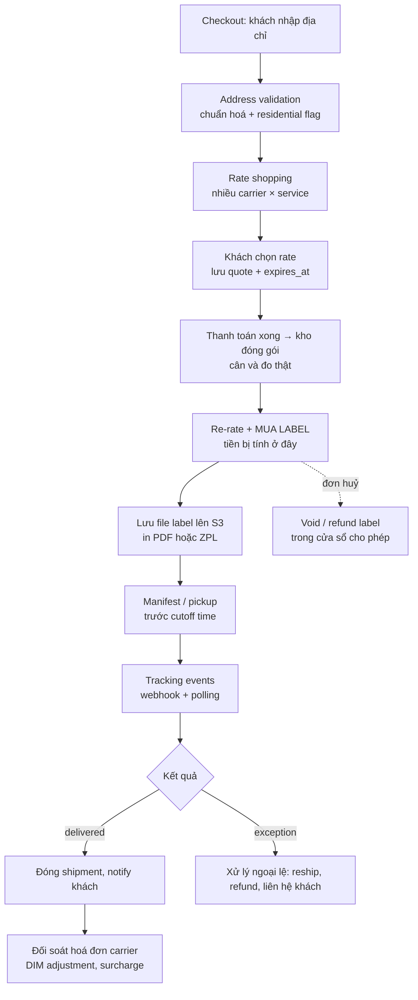

## Bối cảnh & vấn đề

Hãy tưởng tượng bạn vừa vào một team e-commerce, và ticket đầu tiên là "tích hợp UPS để in label". Bạn đọc docs UPS, gọi được API Ship, nhận về một file PDF có barcode. Demo chạy ngon. Ba tuần sau, team finance gửi một bảng tính: tiền UPS tháng này cao hơn tổng giá label trong DB 11%. Kho thì phàn nàn có đơn bị in hai label. Support hỏi vì sao khách đã nhận hàng mà hệ thống vẫn hiện "đang vận chuyển".

Không lỗi nào ở trên nằm ở chỗ "gọi API sai cú pháp". Tất cả đều là lỗi **hiểu sai domain**: không biết carrier tính tiền theo thể tích, không biết label là một giao dịch có tiền, không biết tracking là một dòng sự kiện không tin cậy. Vì thế, câu đầu tiên interviewer hỏi khi JD ghi "proven experience integrating FedEx, UPS, USPS, DHL, EasyPost, Shippo" thường không phải "endpoint nào", mà là "**kể tôi nghe vòng đời một shipment**".

Bài này dựng nền domain đó. Các bài sau đi vào từng phần kỹ thuật: auth và chọn cách tích hợp ([Carrier API & OAuth](/tracks/shipping-apis/learn/carrier-apis-auth)), checkout ([address & rates](/tracks/shipping-apis/learn/address-rates-checkout)), mua label an toàn ([label purchase](/tracks/shipping-apis/learn/label-purchase-idempotency)), tracking ([webhooks](/tracks/shipping-apis/learn/tracking-webhooks)).

## Khái niệm

### Carrier, service level và aggregator

**Carrier** là hãng thật sự cầm kiện hàng đi giao: FedEx, UPS, USPS (bưu chính Mỹ), DHL (mạnh ở quốc tế). Mỗi carrier bán nhiều **service level**: gói dịch vụ quyết định tốc độ và giá. Ví dụ UPS Ground (1–5 ngày làm việc, rẻ), UPS 2nd Day Air, UPS Next Day Air. USPS có Ground Advantage và Priority Mail. Mỗi service có mã riêng trong API (`03` là UPS Ground, `FEDEX_GROUND` là của FedEx), nên hệ thống của bạn cần một bộ mã chuẩn của riêng mình (`ground`, `express_2day`) và map sang mã carrier.

**Aggregator** (EasyPost, Shippo, ShipEngine) là một lớp API bọc nhiều carrier. Bạn gửi một shipment, họ trả về rate của mọi carrier đã kết nối, bạn chọn một rate và "buy". Aggregator thu phí per-label hoặc subscription, đổi lại bạn không phải viết N adapter. Bài [Carrier API & OAuth](/tracks/shipping-apis/learn/carrier-apis-auth) so sánh kỹ hai hướng.

**Interview angle:** interviewer muốn nghe bạn tách bạch "carrier" (ai giao hàng) và "provider" (mình gọi API của ai). Một label UPS có thể được mua qua EasyPost.

### Rate quote và label

**Rate quote** là câu trả lời cho "gửi kiện này từ A đến B bằng service X giá bao nhiêu". Nó chưa phải giao dịch: không ai bị trừ tiền. Rate quote có thời hạn và có thể khác giá cuối cùng vì cân/đo thật khác, surcharge thay đổi, hoặc giá carrier đổi theo đợt.

**Label** là nhãn vận đơn bạn dán lên thùng: địa chỉ gửi/nhận, service, **tracking number** và barcode để carrier scan. Điểm quan trọng nhất: **mua label là lúc tiền bị tính**. Gọi API "create shipment/buy label" thành công nghĩa là carrier (hoặc aggregator) ghi một khoản phí vào tài khoản của bạn. Vì vậy label không phải "một file PDF", mà là một **giao dịch tài chính có file đính kèm**.

Label thường ở khổ **4×6 inch**, định dạng PDF/PNG (in máy văn phòng) hoặc **ZPL** (Zebra Programming Language, ngôn ngữ lệnh của máy in nhiệt). Kho lớn dùng ZPL vì gửi thẳng lệnh cho máy in, nhanh và sắc nét, không cần render PDF.

**Interview angle:** câu "in lại label thì có mua lại không?" kiểm tra bạn có hiểu label là giao dịch không. Đáp án đúng: in lại từ file đã lưu (S3), không bao giờ gọi API mua lần nữa.

### Actual weight, DIM weight và billable weight

Máy bay và xe tải đầy vì **thể tích** trước khi đầy vì cân nặng. Một thùng gối to và nhẹ chiếm chỗ của năm thùng sách. Vì vậy carrier tính tiền theo **billable weight = max(actual weight, dimensional weight)**.

**Dimensional (DIM) weight = L × W × H / divisor**. Với đơn vị inch và pound, divisor phổ biến là **139** cho FedEx/UPS daily rates. USPS dùng **166** cho kiện lớn hơn 1 foot khối. Với cm và kg, nhiều tuyến quốc tế dùng **5000**. Hợp đồng riêng có thể đổi divisor, và các con số này thay đổi theo thời gian (verify trên trang chính thức của từng carrier). Kết quả thường được **làm tròn lên** tới pound nguyên tiếp theo.

Ví dụ: thùng 20×16×12 inch, nặng 5 lb. Thể tích 3840 in³, chia 139 ra 27.6, làm tròn lên 28 lb. Billable là 28 lb chứ không phải 5 lb, tức giá có thể gấp 3–4 lần so với ước tính theo cân nặng.

**Interview angle:** hỏi "vì sao merchant bị carrier tính thêm tiền sau khi giao" là đang thăm dò DIM audit. Hệ thống phải lưu **kích thước** kiện, không chỉ cân nặng.

### Surcharge (accessorial)

Ngoài giá gốc theo billable weight và zone (khoảng cách), carrier cộng **phụ phí**. Hay gặp: **residential** (giao đến nhà ở, FedEx/UPS), **fuel surcharge** (phần trăm, đổi hằng tuần), **delivery area surcharge** (vùng xa), **additional handling** (thùng quá dài, quá nặng, không phải thùng carton), **address correction** (carrier phải sửa địa chỉ bạn khai sai), **signature required**, **Saturday delivery**.

Có những surcharge biết trước khi mua label (signature, residential nếu address validation trả đúng cờ), và có những surcharge chỉ biết khi carrier đã cầm kiện (address correction, additional handling phát hiện ở hub). Nhóm thứ hai xuất hiện dưới dạng **adjustment** trên hoá đơn, đôi khi vài tuần sau.

### Manifest, end-of-day close và pickup

**Manifest** là danh sách các kiện bạn bàn giao trong một lần. Với USPS có **SCAN Form**: một barcode đại diện cả lô, nhân viên bưu điện scan một lần và tất cả kiện có "accepted" scan. FedEx Ground có quy trình **end-of-day close** (verify yêu cầu hiện tại, vì FedEx đã thay đổi quy trình này qua các phiên bản API).

**Pickup** là đặt lịch để carrier đến lấy hàng tại kho: ngày, khung giờ, địa chỉ, số kiện, tổng cân. Khác với **drop-off**, khi bạn mang hàng đến điểm gửi. Mỗi carrier có **cutoff time**: sau giờ đó, kiện sẽ được tính là gửi ngày hôm sau, và điều này ảnh hưởng trực tiếp đến lời hứa ngày giao.

### Void, refund và return label

**Void/refund**: label đã mua nhưng không dùng (đơn bị huỷ, in nhầm) có thể huỷ để lấy lại tiền. Mỗi carrier có **cửa sổ thời gian** và quy trình khác nhau. UPS và FedEx thường cho void trước khi có scan; USPS hoàn tiền qua yêu cầu và xử lý trong nhiều ngày; aggregator trả về trạng thái refund như `submitted`, `refunded`, `rejected` (verify thời hạn cụ thể với docs hiện tại). Label đã có scan thì gần như không void được.

**Return label** cho khách gửi hàng trả. Loại phổ biến là **pay-on-use** (scan-based): label in sẵn trong hộp, chỉ bị tính tiền khi khách thực sự gửi và carrier scan. Ngược lại, return label trả trước bị tính tiền ngay cả khi khách không dùng.

## Cơ chế hoạt động

Toàn bộ vòng đời một shipment, từ checkout đến đối soát, trông như sau:



Đọc sơ đồ theo **ba điểm tiền**. Điểm thứ nhất là **mua label** (F): carrier tính tiền theo thông tin bạn khai. Điểm thứ hai là **đối soát** (R): carrier đo lại ở hub và gửi adjustment nếu bạn khai sai, hoặc nếu có surcharge phát sinh. Điểm thứ ba là **void/refund** (V): tiền quay về, nhưng chỉ khi bạn làm trong thời hạn và refund không bị từ chối.

Đọc theo **ba điểm dễ lỗi kỹ thuật**. Ở C, gọi nhiều carrier song song với ngân sách thời gian chặt, vì một carrier chậm có thể làm treo checkout. Ở F, đây là side effect có tiền và không idempotent phía carrier; timeout ở đây là tình huống nguy hiểm nhất. Ở I, sự kiện đến trùng, sai thứ tự hoặc mất.

Một chi tiết hay bị bỏ qua: bước E và F thường cách nhau vài giờ đến vài ngày. Giá ở bước D là **quote**, được tính trên cân/đo ước lượng từ dữ liệu sản phẩm. Ở bước F, kho đóng gói thật, có thể dùng thùng khác, nên hệ thống **re-rate** rồi mới mua. Chênh lệch giữa D và F phải có chính sách rõ ràng: platform chịu, merchant chịu, hay chặn lại khi vượt ngưỡng.

**Interview angle:** khi kể vòng đời, hãy nói rõ chỗ nào tiền di chuyển và chỗ nào không retry mù được. Đó là tín hiệu senior.

## Ví dụ thực tế

### Tính billable weight cho ba kiện hàng

Đoạn code dưới tính billable weight với divisor 139 (inch, pound). Chạy bằng `npx tsx dim.ts`.

```ts
type Parcel = { lengthIn: number; widthIn: number; heightIn: number; weightLb: number };

function billableWeightLb(p: Parcel, divisor = 139) {
  const dim = Math.ceil((p.lengthIn * p.widthIn * p.heightIn) / divisor);
  const actual = Math.ceil(p.weightLb);
  return { actual, dim, billable: Math.max(actual, dim) };
}

const parcels: Record<string, Parcel> = {
  'book (small, heavy)': { lengthIn: 10, widthIn: 8, heightIn: 3, weightLb: 4.2 },
  'pillow (big, light)': { lengthIn: 20, widthIn: 16, heightIn: 12, weightLb: 5 },
  'pillow, smaller box': { lengthIn: 18, widthIn: 14, heightIn: 8, weightLb: 5 },
};
for (const [name, p] of Object.entries(parcels)) console.log(name.padEnd(22), billableWeightLb(p));
```

Output:

```text
book (small, heavy)    { actual: 5, dim: 2, billable: 5 }
pillow (big, light)    { actual: 5, dim: 28, billable: 28 }
pillow, smaller box    { actual: 5, dim: 15, billable: 15 }
```

Quan sát: cùng một cái gối 5 lb, đổi sang thùng nhỏ hơn giảm billable weight từ 28 xuống 15 lb, tức gần một nửa chi phí. Đây là lý do các hệ thống fulfillment có **packaging rule** (chọn thùng nhỏ nhất vừa) và vì sao dữ liệu kích thước SKU sai lại tốn tiền thật.

### Vòng đời qua một aggregator (EasyPost, dạng rút gọn)

Với aggregator, các bước F–I tương ứng với vài call (rút gọn, verify field theo docs hiện tại):

```bash
# 1. Tạo shipment → nhận danh sách rates
curl -s -u "$EASYPOST_TEST_KEY:" https://api.easypost.com/v2/shipments \
  -H 'Content-Type: application/json' \
  -d '{"shipment":{"to_address":{...},"from_address":{...},"parcel":{"length":20,"width":16,"height":12,"weight":80}}}'
# → { "id": "shp_...", "rates": [ { "id": "rate_...", "carrier": "UPS", "service": "Ground", "rate": "14.32" }, ... ] }

# 2. Mua một rate cụ thể → label + tracking
curl -s -u "$EASYPOST_TEST_KEY:" https://api.easypost.com/v2/shipments/shp_.../buy \
  -d '{"rate":{"id":"rate_..."}}'
# → { "tracking_code": "1Z...", "postage_label": { "label_url": "https://..." }, "selected_rate": {...} }
```

Lưu ý `weight` của EasyPost tính bằng **ounce** (80 oz = 5 lb), còn `rate` là **chuỗi** số tiền. Hai chi tiết nhỏ này gây ra nhiều bug unit và money (xem [kiến trúc adapter](/tracks/shipping-apis/learn/adapter-architecture)).

## Trade-offs & lựa chọn thay thế

| Quyết định | Lựa chọn A | Lựa chọn B | Khi nào chọn |
|---|---|---|---|
| Thời điểm mua label | Ngay khi order paid | Khi kho đóng gói xong | A khi cân/đo chuẩn và cần tracking sớm. B gần như luôn đúng hơn vì cân/đo thật, tránh adjustment và void |
| Cách bàn giao | Pickup hằng ngày | Drop-off | Pickup khi volume ổn định. Drop-off cho merchant nhỏ |
| Return label | Pay-on-use in sẵn | Tạo theo yêu cầu khi khách request return | In sẵn tăng trải nghiệm. Theo yêu cầu kiểm soát được gian lận và lý do trả |
| Label format | PDF/PNG | ZPL | ZPL cho kho có máy in nhiệt. PDF cho văn phòng nhỏ |
| Quote ở checkout | Theo cân nặng sản phẩm | Theo billable weight (có dims + packaging rule) | B chính xác hơn nhiều, đổi lại cần dữ liệu kích thước SKU |

Chọn thế nào: nếu bạn là platform phục vụ nhiều merchant nhỏ, ưu tiên đơn giản (PDF, drop-off, return theo yêu cầu) và đầu tư vào dữ liệu kích thước. Nếu bạn vận hành kho lớn, ưu tiên ZPL, pickup cố định, manifest tự động và packaging rule, vì vài phần trăm chênh lệch DIM nhân với volume là tiền rất lớn.

## Edge cases & failure modes

- **Label mua rồi nhưng đơn bị huỷ**: nếu không có job void tự động, tiền mất. Job cần biết cửa sổ void của từng carrier, và phải xử lý refund bị `rejected`.
- **Label đã nằm trong manifest rồi mới void**: tuỳ carrier, manifest có thể cần tạo lại, hoặc kiện bị đánh dấu "not received". Job close cuối ngày chỉ nên gom label chưa void và phải idempotent.
- **Kho in lại label bằng cách bấm "Buy" lần nữa**: tạo label mới, tracking mới, tiền mới. Hai label cùng dán một thùng thì tracking của khách trỏ vào label không được scan.
- **Kích thước sản phẩm thiếu hoặc sai**: quote theo cân nặng, carrier tính theo DIM → adjustment hàng loạt cuối tháng.
- **Qua cutoff time**: hệ thống vẫn hứa "giao thứ Năm" theo transit time, nhưng kiện thực tế gửi ngày hôm sau → trễ hẹn.
- **Peak season**: carrier thêm **peak surcharge** và đôi khi giới hạn volume theo account. Quote cache cũ không còn đúng.

## Pitfalls

- ❌ Coi label là file PDF → ✅ coi label là **giao dịch có tiền**, lưu file lên storage của mình và in lại từ đó.
- ❌ Chỉ lưu cân nặng sản phẩm → ✅ lưu **kích thước** và loại packaging, quote theo billable weight.
- ❌ Coi giá quote ở checkout là giá cuối → ✅ lưu cả quoted, purchased và invoiced cost, có chính sách cho chênh lệch.
- ❌ Gửi yêu cầu refund là coi như đã nhận tiền → ✅ theo dõi trạng thái refund đến khi `refunded` hoặc `rejected`.
- ❌ Return label trả trước cho mọi đơn → ✅ pay-on-use hoặc tạo theo yêu cầu.
- ❌ Bỏ qua cutoff time và ngày lễ → ✅ đưa cutoff vào cả lịch manifest/pickup lẫn tính ngày giao dự kiến.

## Tóm tắt

- Vòng đời: **validate address → rate → mua label → manifest/pickup → tracking → void/return → đối soát**.
- Tiền di chuyển ở ba chỗ: **mua label**, **adjustment trên hoá đơn**, **void/refund**.
- **Billable weight = max(actual, DIM)**, DIM = L×W×H / divisor (139 cho in/lb FedEx/UPS daily, 166 cho USPS kiện lớn, 5000 cho cm/kg; verify theo hợp đồng).
- Surcharge biết trước (residential, signature) và biết sau (address correction, additional handling).
- Label là giao dịch, không phải file: in lại từ S3, **không mua lại**.
- Manifest/pickup gắn với **cutoff time**; void/refund có **cửa sổ thời gian** và có thể bị từ chối.
- Return label nên là **pay-on-use** để chỉ trả tiền khi khách thật sự gửi.
