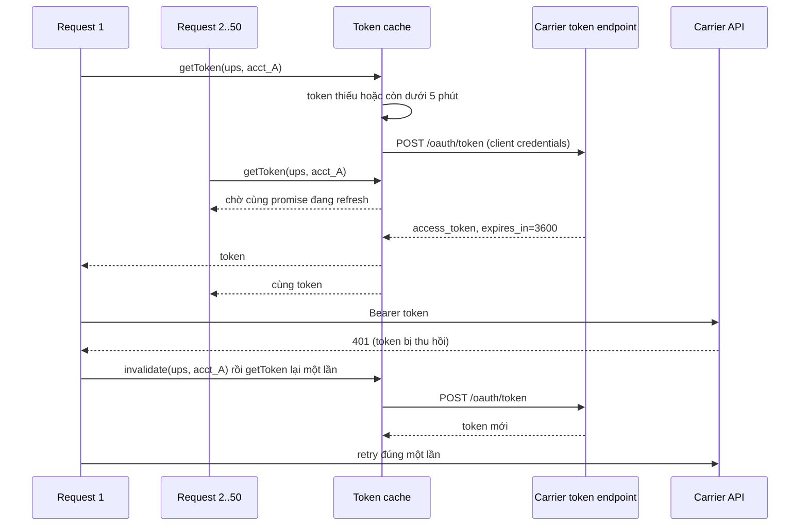

## Bối cảnh & vấn đề

Ba năm trước, một team tích hợp FedEx bằng SOAP Web Services, UPS bằng access key trong header XML, và USPS bằng Web Tools với tham số `USERID` trong URL. Mọi thứ chạy ổn cho đến khi lần lượt từng carrier gửi email: API cũ sẽ ngừng hoạt động, hãy chuyển sang REST + OAuth 2.0. Team không ai còn nhớ code cũ, không có test, và deadline trùng mùa cao điểm. Đó là lý do câu hỏi "**bạn đã migrate khỏi legacy carrier API chưa?**" xuất hiện trong nhiều buổi phỏng vấn cho JD kiểu này.

Bài toán thứ hai đến sớm hơn: chọn **tích hợp thẳng từng carrier** hay đi qua **aggregator**. Lựa chọn này quyết định bạn viết bao nhiêu code, trả bao nhiêu tiền mỗi label, và khi có sự cố thì gọi ai.

Bài toán thứ ba nhỏ hơn nhưng gây sự cố nhiều nhất: **quản lý OAuth token**. Token sống khoảng một giờ. Code xin token mới cho mỗi request thì chậm và bị rate limit; code cache sai key thì gọi API bằng account của merchant khác. Bài này đi qua cả ba, dựa trên nền domain ở [bài 1](/tracks/shipping-apis/learn/shipping-domain).

## Khái niệm

### Direct carrier API

Mỗi carrier lớn có developer portal riêng: FedEx (developer.fedex.com), UPS (developer.ups.com), USPS (developers.usps.com), DHL (developer.dhl.com, với nhiều API riêng cho DHL Express, DHL eCommerce, tracking hợp nhất). Mỗi API có **schema riêng** (UPS lồng sâu kiểu `ShipmentRequest.Shipment.Package[]`, FedEx dùng `requestedShipment`), **mã service riêng**, **mã lỗi riêng**, và **quy trình go-live riêng**: một số carrier yêu cầu đăng ký app, gắn account number, và có hãng yêu cầu certification label trước khi mở production (verify yêu cầu hiện tại của từng hãng).

Lợi ích của direct: không trả phí trung gian, dùng được **giá đàm phán** trên account của mình, và truy cập tính năng sâu mà aggregator chưa hỗ trợ (pickup đặc thù, freight, một số tuỳ chọn hải quan). Cái giá là bạn tự maintain N adapter và tự theo dõi N lịch deprecation.

### Aggregator (multi-carrier API)

**EasyPost, Shippo, ShipEngine** bọc nhiều carrier sau một API thống nhất. Mô hình chung: tạo **Shipment** (địa chỉ, parcel) → nhận **Rates** của mọi carrier đã kết nối → **buy** một rate → nhận label và tracking. Shippo gọi bước mua là tạo **Transaction**. Ngoài ra aggregator có sẵn address verification, **Tracker** + webhook với status đã chuẩn hoá, insurance, và thường có customs/duties cho quốc tế.

Aggregator cho phép dùng **account của aggregator** (giá của họ, thường đã chiết khấu) hoặc **kết nối account carrier của merchant** (BYOA). Cái giá: phí per-label hoặc subscription, phụ thuộc uptime và roadmap của vendor, và đôi khi bị chậm nhịp khi carrier ra tính năng mới.

**Interview angle:** không có đáp án đúng tuyệt đối. Interviewer muốn nghe tiêu chí (volume, số carrier, team size, tính năng cần, chi phí) và cách bạn **giữ khả năng đổi hướng**.

### OAuth 2.0 client credentials

Đây là luồng OAuth dành cho **server gọi server**, không có người dùng đăng nhập (RFC 6749 §4.4). Server gửi `client_id` + `client_secret` (thường qua header `Authorization: Basic base64(id:secret)`, hoặc trong body tuỳ carrier) tới **token endpoint**, nhận về `access_token` và `expires_in`. Mọi call API sau đó gắn `Authorization: Bearer <token>`. FedEx, UPS và USPS API mới đều theo mô hình này, với token sống khoảng một giờ (verify con số cụ thể từng hãng). Không có refresh token: hết hạn thì xin token mới bằng client credentials.

Với BYOA, mỗi merchant có **client credentials hoặc account riêng**, nên bạn có nhiều token song song. Một số carrier có luồng uỷ quyền để merchant "kết nối" account mà không đưa secret thô cho bạn (verify hỗ trợ cụ thể).

### API key của aggregator

**EasyPost** dùng API key qua HTTP Basic auth (key là username, password để trống), với **test key và production key riêng biệt**. Test key mua label giả, không tốn tiền. **Shippo** dùng header `Authorization: ShippoToken <key>`, cũng có test token và live token. API key không hết hạn như OAuth token, nên rủi ro chính là **lộ key**: key production phải nằm trong secret manager, không log và không đưa vào frontend.

### Token cache, proactive refresh và single-flight

**Token cache** lưu access token theo **(carrier, account, environment)** cùng thời điểm hết hạn. **Proactive refresh** nghĩa là xin token mới khi còn vài phút, không đợi đến lúc request bị 401. **Single-flight** nghĩa là khi nhiều request cùng thấy token sắp hết hạn, chỉ **một** request thật sự gọi token endpoint, các request khác chờ cùng promise đó. Không có single-flight, 50 request đồng thời sẽ xin 50 token: chậm, có thể bị rate limit token endpoint, và với carrier vô hiệu hoá token cũ khi phát token mới thì còn gây 401 dây chuyền (verify hành vi từng carrier).

### Deprecation và legacy API

Các carrier đã hoặc đang khai tử API cũ: **FedEx SOAP Web Services** chuyển sang FedEx REST APIs, **UPS access-key auth** chuyển sang OAuth 2.0, **USPS Web Tools** (XML) chuyển sang USPS APIs mới (verify mốc thời gian chính thức của từng hãng trước khi nêu ngày cụ thể trong phỏng vấn). Khi migrate, thứ thay đổi không chỉ là auth: tên field, cách làm tròn giá, mã service, mã lỗi, format label, và có service bị bỏ hoặc đổi tên.

## Cơ chế hoạt động

Luồng lấy token có single-flight cho một carrier account:



Đọc sơ đồ: cache key luôn gồm **account**, không chỉ carrier. Request đầu tiên thấy token thiếu thì tạo một promise refresh và lưu vào bảng "đang bay" (in-flight). Các request khác thấy promise này và chờ nó thay vì tạo cái mới. Khi refresh xong, promise bị xoá khỏi bảng in-flight; nếu refresh **thất bại**, nó cũng bị xoá, để lần sau thử lại chứ không cache một lỗi.

Nhánh dưới là cách xử lý **401**: token có thể bị thu hồi trước hạn (merchant rotate secret, carrier reset). Xử lý đúng là invalidate, refresh một lần, retry request đúng một lần. Lần hai vẫn 401 thì đây là lỗi credential thật: dừng, đánh dấu account `needs_reauth`, báo merchant. **Không** retry vô hạn.

Với nhiều instance (nhiều pod), cache trong memory nghĩa là mỗi pod xin token riêng. Thường thế là chấp nhận được (10 pod, mỗi giờ 10 token). Nếu carrier giới hạn chặt số token hoặc vô hiệu hoá token cũ, chuyển cache sang Redis và dùng lock ngắn khi refresh.

## Ví dụ thực tế

### Token cache: naive và single-flight

Mô phỏng 50 request đồng thời cần token, token endpoint mất 50 ms. Chạy bằng `npx tsx token.ts`.

```ts
type Token = { value: string; expiresAt: number };
let fetches = 0;
async function fetchToken(accountId: string): Promise<Token> {
  fetches++;
  await new Promise((r) => setTimeout(r, 50));                       // network round-trip
  return { value: `tok_${accountId}_${fetches}`, expiresAt: Date.now() + 3600_000 };
}

// Naive: check-then-fetch, no sharing of in-flight refresh
const naiveCache = new Map<string, Token>();
async function naiveGet(accountId: string) {
  const t = naiveCache.get(accountId);
  if (t && t.expiresAt > Date.now()) return t.value;
  const fresh = await fetchToken(accountId);
  naiveCache.set(accountId, fresh);
  return fresh.value;
}

// Single-flight + refresh buffer, keyed per account
const cache = new Map<string, Token>();
const inflight = new Map<string, Promise<Token>>();
const BUFFER_MS = 5 * 60_000;
async function getToken(accountId: string) {
  const t = cache.get(accountId);
  if (t && t.expiresAt - BUFFER_MS > Date.now()) return t.value;
  let p = inflight.get(accountId);
  if (!p) {
    p = fetchToken(accountId)
      .then((fresh) => { cache.set(accountId, fresh); return fresh; })
      .finally(() => inflight.delete(accountId));                     // a rejected refresh is not cached
    inflight.set(accountId, p);
  }
  return (await p).value;
}

(async () => {
  await Promise.all(Array.from({ length: 50 }, () => naiveGet('ups_acct_A')));
  console.log('naive        token fetches for 50 concurrent calls:', fetches);
  fetches = 0;
  await Promise.all(Array.from({ length: 50 }, () => getToken('ups_acct_A')));
  await Promise.all(Array.from({ length: 50 }, () => getToken('ups_acct_B')));
  console.log('single-flight token fetches for 2 accounts x 50 calls:', fetches);
})();
```

Output:

```text
naive        token fetches for 50 concurrent calls: 50
single-flight token fetches for 2 accounts x 50 calls: 2
```

Bản naive gọi token endpoint 50 lần, vì cả 50 request đều kiểm tra cache **trước khi** request đầu tiên kịp ghi vào. Đây là race "check-then-act" kinh điển, chỉ khác là trong Node nó xảy ra giữa các `await`. Bản single-flight gọi đúng một lần cho mỗi account. Cache key là `accountId`; trong code thật nên là `${carrier}:${accountId}:${env}`.

### So sánh request mua label: direct vs aggregator

Cùng ý nghĩa "mua label UPS Ground", hai hình dạng rất khác nhau (rút gọn, verify field theo docs hiện tại):

```bash
# Direct UPS (OAuth Bearer, JSON lồng sâu, đơn vị khai tường minh)
curl -s "https://onlinetools.ups.com/api/shipments/$UPS_API_VERSION/ship" \
  -H "Authorization: Bearer $UPS_TOKEN" -H 'Content-Type: application/json' \
  -d '{"ShipmentRequest":{"Shipment":{"Service":{"Code":"03"},
       "Package":[{"PackageWeight":{"UnitOfMeasurement":{"Code":"LBS"},"Weight":"5"}}], ...}}}'

# EasyPost (Basic auth với API key, buy một rate đã báo giá)
curl -s -u "$EASYPOST_KEY:" https://api.easypost.com/v2/shipments/shp_123/buy \
  -d '{"rate":{"id":"rate_456"}}'
```

Điểm cần nói trong phỏng vấn: với direct, adapter phải tự build payload, tự khai đơn vị, tự map mã service `03`. Với aggregator, phần đó đã làm sẵn, nhưng bạn phụ thuộc id của họ (`shp_`, `rate_`). Những id này không được lan ra ngoài shipping service (xem [kiến trúc adapter](/tracks/shipping-apis/learn/adapter-architecture)).

## Trade-offs & lựa chọn thay thế

| Tiêu chí | Direct carrier | Aggregator | Hybrid |
|---|---|---|---|
| Thời gian lên production | Vài tuần mỗi carrier (+ onboarding phía carrier) | Vài ngày cho nhiều carrier | Aggregator trước, direct sau |
| Chi phí mỗi label | Không phí trung gian | Phí per-label hoặc subscription | Phí chỉ cho phần long tail |
| Giá cước | Giá đàm phán của mình | Giá của aggregator hoặc BYOA | Tối ưu theo carrier |
| Maintenance | N adapter, N lịch deprecation | Vendor lo | Ít adapter direct |
| Tính năng sâu | Đầy đủ | Theo những gì vendor hỗ trợ | Đầy đủ cho carrier chính |
| Rủi ro phụ thuộc | Từng carrier | Thêm một vendor ở giữa | Aggregator làm fallback |

**Khi nào chọn gì.** Startup hoặc platform mới, team nhỏ, cần nhiều carrier: aggregator. Volume lớn tập trung vào 1–2 carrier, phí per-label đã thành khoản đáng kể, hoặc cần tính năng aggregator không có: direct cho các carrier đó. Phần lớn công ty trưởng thành đi tới **hybrid**.

Để trả lời câu build-vs-buy (Q040) như senior, đưa ra **phép tính break-even**: phí aggregator mỗi label × volume mỗi năm, so với chi phí kỹ sư build ban đầu + maintain hằng năm + rủi ro sự cố. Sau đó nêu những thứ khó định giá: tracking chuẩn hoá, address verification, customs đang được cho sẵn. Cuối cùng nói cách **giữ quyền chọn**: canonical model + adapter interface từ đầu, `provider` tách khỏi `carrier`, feature flag chọn provider theo tenant/carrier.

**Migrate khỏi legacy API** (Q034): inventory mọi call cũ → adapter mới cùng interface → **shadow mode** cho các thao tác đọc (rate, track, address), so sánh kết quả hai bên → test label production thật rồi void, kiểm tra in ZPL ở kho → rollout theo tenant bằng feature flag → rollback bằng flag. Bắt đầu sớm, vì onboarding OAuth app cho từng merchant BYOA cần merchant thao tác, và đó là phần chậm nhất.

## Edge cases & failure modes

- **Token hết hạn đúng lúc request đang bay**: kiểm tra `expiresAt > now` sát giờ thì token đến carrier đã hết hạn → 401. Dùng buffer vài phút.
- **Refresh thất bại** (token endpoint 5xx): mọi request đang chờ promise đều nhận lỗi. Không cache lỗi; request sau thử lại với backoff. Nếu token cũ vẫn còn hạn thật, có thể tạm dùng nó.
- **Merchant rotate secret không báo**: refresh trả 401/`invalid_client`. Đánh dấu account `needs_reauth`, dừng các job của account đó (không retry đến mức bị khoá), thông báo merchant. Account khác không bị ảnh hưởng.
- **Cache key thiếu account**: tenant A gọi API bằng token của tenant B → giá sai, label tính tiền nhầm account. Đây là **data leak**, mức nghiêm trọng cao nhất.
- **Sandbox và production khác nhau**: khác base URL, khác credentials, đôi khi khác cả schema. Environment phải nằm trong cache key và trong config, không suy ra từ một biến boolean rải rác.
- **Deprecation âm thầm**: carrier trả header hoặc warning báo field sắp bị bỏ. Không ai đọc → một ngày API trả lỗi. Log và alert khi response có warning deprecation.

## Pitfalls

- ❌ Xin token mới cho mỗi request → ✅ cache theo account + proactive refresh + single-flight.
- ❌ Cache key chỉ theo carrier → ✅ `(carrier, account, env)`.
- ❌ Retry 401 vô hạn → ✅ invalidate, refresh, retry đúng một lần, rồi báo lỗi credential.
- ❌ Lưu client secret của merchant dạng plaintext → ✅ envelope encryption (KMS), chỉ adapter giải mã, có audit log.
- ❌ Dùng production API key trong test hoặc CI → ✅ test key riêng, kiểm tra prefix key khi khởi động service.
- ❌ Đợi đến sát deadline mới migrate legacy API → ✅ inventory sớm, shadow mode, rollout dần.
- ❌ Trả lời "tôi đã tích hợp tất cả các carrier trong JD" → ✅ nói đúng phạm vi đã làm, rồi chứng minh hiểu domain và đưa ví dụ cụ thể (Q047).

## Tóm tắt

- Hai cách tích hợp: **direct** (kiểm soát, giá đàm phán, tốn công maintain) và **aggregator** (nhanh, nhiều carrier, phí và phụ thuộc vendor). Thực tế thường **hybrid**.
- FedEx, UPS, USPS API mới dùng **OAuth 2.0 client credentials**, token ngắn hạn, không có refresh token. EasyPost/Shippo dùng **API key** với test key và live key riêng.
- Token cache: key `(carrier, account, env)`, **refresh trước hạn**, **single-flight**, 401 thì refresh rồi retry đúng một lần.
- Legacy API đã hoặc đang bị khai tử: migrate bằng adapter mới + shadow mode + feature flag, bắt đầu sớm.
- Giữ quyền chọn bằng canonical model, `provider` tách khỏi `carrier`, id của vendor không lan ra ngoài.
- Khi được hỏi kinh nghiệm: trung thực về phạm vi, chứng minh bằng hiểu biết domain và một demo tự làm.
