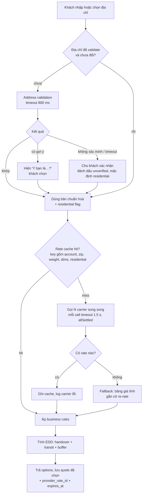

## Bối cảnh & vấn đề

Thứ Sáu đen tối, conversion rate ở trang checkout tụt 18% trong một giờ. Dashboard cho thấy p95 của API "get shipping options" nhảy từ 900 ms lên 31 giây. Nguyên nhân: một carrier bị chậm, và code rate shopping dùng `Promise.all` không có timeout, nên cả trang chờ carrier đó. Khách thấy spinner, bỏ giỏ hàng. Đơn hàng mất không phải vì carrier sập, mà vì **checkout không biết bỏ qua carrier chậm**.

Một ngày khác, merchant khiếu nại phí ship luôn thấp hơn hoá đơn khoảng $4–5 mỗi kiện. Nguyên nhân: checkout không gửi cờ residential, nên quote không có **residential surcharge**, trong khi carrier tính khi giao tới nhà ở.

Checkout là nơi shipping integration chạm trực tiếp vào doanh thu: quá chậm thì mất đơn, quá rẻ thì mất margin, quá đắt thì mất khách, hứa sai ngày thì mất niềm tin. Bài này nối tiếp [domain vận chuyển](/tracks/shipping-apis/learn/shipping-domain) và [carrier API](/tracks/shipping-apis/learn/carrier-apis-auth), tập trung vào ba việc ở checkout: **địa chỉ**, **giá**, **ngày giao**.

## Khái niệm

### Address validation và chuẩn hoá

**Address validation** kiểm tra địa chỉ có tồn tại và giao được không, đồng thời **chuẩn hoá** nó theo format bưu chính: viết hoa, viết tắt chuẩn (`Street` → `ST`, `Apartment` → `APT`), thêm ZIP+4 ở Mỹ. Ở Mỹ, nguồn chuẩn là dữ liệu USPS; khái niệm hay gặp là **DPV** (Delivery Point Validation: địa chỉ có phải điểm giao thật không) và **RDI** (Residential Delivery Indicator: nhà ở hay doanh nghiệp).

Nguồn validation: USPS Addresses API, UPS Address Validation (phạm vi chủ yếu US và Puerto Rico ở mức street, verify), FedEx Address Validation, hoặc qua aggregator (EasyPost verify address, Shippo address validation). Quốc tế thì dữ liệu yếu hơn nhiều; thường chỉ kiểm tra được format postal code theo nước.

### Residential flag

FedEx và UPS tính **residential surcharge** khi giao tới nhà ở, và giá giao nhà ở có thể theo bảng khác (ví dụ FedEx Home Delivery). Quote ở checkout phải biết cờ này. Cách lấy: từ kết quả address validation (RDI), hoặc mặc định "residential" cho đơn B2C khi không chắc. Mặc định sai hướng "commercial" là cách nhanh nhất để mất vài đô mỗi đơn.

### Rate shopping

**Rate shopping** là hỏi giá nhiều carrier và service cho cùng một kiện, rồi chọn hoặc cho khách chọn. Ở checkout có ngân sách thời gian chặt, khoảng 1.5–2 giây cho toàn bộ. Ba kỹ thuật bắt buộc: gọi **song song**, mỗi call có **timeout riêng**, và gom kết quả bằng **`Promise.allSettled`** để carrier lỗi không kéo theo carrier khác. Khi không carrier nào trả kịp, dùng **fallback**: bảng giá tĩnh theo zone/cân, flat rate, hoặc quote cache gần nhất, kèm cờ để re-rate lúc mua label.

**Interview angle:** câu debug kinh điển (Q024) là đoạn code `Promise.all` không timeout. Bạn cần chỉ ra cả hai lỗi và giải thích hậu quả với khách hàng, không chỉ với code.

### Business rules sau khi có giá

Giá carrier chưa phải giá hiển thị. Sau khi có rate, hệ thống áp **rule**: markup hoặc discount, free shipping khi đơn vượt ngưỡng, ẩn service quá chậm, ẩn carrier không giao tới PO Box, giới hạn số option (khách không cần 14 lựa chọn), đặt tên thân thiện ("Tiêu chuẩn 3–5 ngày" thay vì "UPS Ground"). Rule thường **theo tenant** trên platform multi-tenant.

### Rate cache

**Rate cache** giúp khách sửa giỏ hàng hay quay lại checkout không phải chờ carrier lần nữa. Key phải chứa **mọi thứ làm giá thay đổi**: carrier account (giá đàm phán theo tenant), origin và destination (postal code + country), residential, billable weight (làm tròn theo bậc carrier tính giá), dims, service, các tuỳ chọn (signature, insurance). TTL ngắn, từ vài phút đến vài giờ. Thiếu `account_id` trong key là **rò rỉ giá giữa các tenant**, không chỉ là sai giá.

### Estimated delivery date (EDD)

**EDD** là lời hứa "nhận hàng trước thứ Năm". Nó bằng **thời điểm handover cho carrier** (thời gian xử lý của kho, cutoff time, ngày làm việc, ngày lễ) cộng **transit time** (carrier trả ETA hoặc time-in-transit; hoặc mô hình tự học) cộng **buffer**. Transit time của carrier thường lạc quan; hệ thống trưởng thành học phân phối thời gian giao thực tế theo (carrier, service, zone, mùa) và hứa theo **percentile** (p85–p90), không theo trung bình.

## Cơ chế hoạt động

Luồng lấy shipping options ở checkout:



Giải thích theo thứ tự. Address validation chỉ chạy khi địa chỉ mới hoặc đã đổi; kết quả lưu kèm `validated_at` để không validate lại mỗi lần tải trang. Validation **không chặn cứng**: khi không xác minh được, khách vẫn đặt hàng được, nhưng đơn mang cờ `unverified` để kho hoặc support để ý.

Rate shopping kiểm tra cache trước. Khi miss, gọi các carrier song song, mỗi call có `AbortSignal.timeout`. Kết quả về qua `Promise.allSettled`: carrier thành công thì lấy giá, carrier lỗi hoặc quá thời gian thì log và bỏ qua. Nếu **không còn rate nào**, fallback sang bảng giá tĩnh, để khách vẫn đặt được hàng. Cuối cùng áp business rules và tính EDD.

Quote khách chọn được lưu cùng `provider_rate_id` (để mua đúng rate đó nếu còn hạn) và `expires_at`. Lúc mua label, hệ thống re-rate theo cân/đo thật như mô tả ở [bài mua label](/tracks/shipping-apis/learn/label-purchase-idempotency).

## Ví dụ thực tế

### Rate shopping với một carrier lỗi và một carrier treo

Bốn carrier giả: UPS (300 ms), FedEx (450 ms), USPS (trả 500), DHL (treo 9 giây). Ngân sách 1.5 giây. Chạy bằng `npx tsx rates.ts`.

```ts
type Rate = { carrier: string; service: string; amountCents: number };
const sleep = (ms: number, signal: AbortSignal) => new Promise<void>((res, rej) => {
  const t = setTimeout(res, ms);
  signal.addEventListener('abort', () => { clearTimeout(t); rej(signal.reason); });
});
// fake carriers: latency + behavior
const carriers = [
  { name: 'ups',   ms: 300,  fail: false, rates: [{ service: 'ground', amountCents: 1432 }, { service: 'express_2day', amountCents: 2890 }] },
  { name: 'fedex', ms: 450,  fail: false, rates: [{ service: 'ground', amountCents: 1388 }] },
  { name: 'usps',  ms: 200,  fail: true,  rates: [] },               // returns 500
  { name: 'dhl',   ms: 9000, fail: false, rates: [{ service: 'express_2day', amountCents: 3120 }] }, // hangs
];
async function quote(c: (typeof carriers)[number], signal: AbortSignal): Promise<Rate[]> {
  await sleep(c.ms, signal);
  if (c.fail) throw new Error("HTTP 500");
  return c.rates.map((r) => ({ carrier: c.name, ...r }));
}
async function rateShop(budgetMs: number) {
  const started = Date.now();
  const results = await Promise.allSettled(carriers.map((c) => quote(c, AbortSignal.timeout(budgetMs))));
  const rates = results.flatMap((r) => (r.status === 'fulfilled' ? r.value : []));
  const errors = results.flatMap((r, i) => (r.status === 'rejected' ? [`${carriers[i].name}: ${(r.reason as Error).name === 'TimeoutError' ? 'timeout' : (r.reason as Error).message}`] : []));
  rates.sort((a, b) => a.amountCents - b.amountCents);
  return { tookMs: Math.round((Date.now() - started) / 100) * 100, rates, errors };
}
rateShop(1500).then((r) => console.log(JSON.stringify(r, null, 2)));
```

Output:

```json
{
  "tookMs": 1500,
  "rates": [
    { "carrier": "fedex", "service": "ground", "amountCents": 1388 },
    { "carrier": "ups", "service": "ground", "amountCents": 1432 },
    { "carrier": "ups", "service": "express_2day", "amountCents": 2890 }
  ],
  "errors": ["usps: HTTP 500", "dhl: timeout"]
}
```

Khách nhận ba lựa chọn sau đúng 1.5 giây, thay vì lỗi trắng trang (nếu dùng `Promise.all`, USPS làm hỏng tất cả) hoặc chờ 9 giây (nếu không timeout). Mảng `errors` đi vào log và metric "tỉ lệ timeout theo carrier". Lưu ý một chi tiết: thời gian tổng bằng carrier **chậm nhất trong ngân sách**. Nếu một carrier thường xuyên chạm timeout, nó kéo p95 của cả checkout lên 1.5 giây. Câu follow-up của Q024 hỏi đúng điều này. Các hướng xử lý: ngân sách riêng ngắn hơn cho carrier đó, trả kết quả **streaming** (hiện option nhanh trước), hoặc **prefetch** rate ngay khi khách nhập xong địa chỉ thay vì đợi bấm "Tiếp tục".

### Cache key cho rate

```ts
function rateCacheKey(i: {
  tenantId: string; carrierAccountId: string;
  from: { country: string; postal: string }; to: { country: string; postal: string; residential: boolean };
  billableLb: number; dimsIn: [number, number, number]; options: string[];
}) {
  const dims = i.dimsIn.map((d) => Math.ceil(d)).sort((a, b) => b - a).join('x'); // orientation-independent
  return ['rate', i.tenantId, i.carrierAccountId, i.from.country, i.from.postal, i.to.country, i.to.postal,
    i.to.residential ? 'res' : 'com', Math.ceil(i.billableLb), dims, [...i.options].sort().join(',')].join(':');
}
// rate:t_42:ups_acct_7:US:94107:US:10001:res:28:20x16x12:signature
```

Cân nặng làm tròn lên theo pound vì carrier tính giá theo bậc pound; dims sắp xếp để thùng 12×16×20 và 20×16×12 dùng chung key. Có cả `tenantId` và `carrierAccountId` để không bao giờ trả giá của tenant này cho tenant khác.

## Trade-offs & lựa chọn thay thế

| Quyết định | Lựa chọn A | Lựa chọn B | Khi nào chọn |
|---|---|---|---|
| Nguồn giá | Realtime từ carrier | Bảng giá tĩnh / flat rate | Realtime khi giá biến động và margin mỏng. Tĩnh khi cần nhanh, ổn định, merchant chấp nhận chênh lệch. Thực tế: realtime + cache + fallback tĩnh |
| Address validation | Chặn cứng | Gợi ý + khách xác nhận | Gần như luôn chọn B; validator có false negative với nhà mới, nông thôn, quốc tế |
| Thời điểm gọi rate | Khi khách bấm "Tiếp tục" | Prefetch khi địa chỉ hợp lệ | Prefetch giảm latency cảm nhận, đổi lại tốn quota cho khách bỏ ngang |
| Trả kết quả | Chờ đủ rồi trả một lần | Streaming từng carrier | Streaming khi một carrier hay chậm; phức tạp UI hơn |
| EDD | Theo transit time carrier | Theo dữ liệu giao thực tế (percentile) | Bắt đầu bằng carrier, chuyển sang dữ liệu khi có đủ lịch sử |
| Ai chịu chênh lệch quote–label | Merchant | Platform | Ghi rõ trong hợp đồng; hệ thống chặn mua label khi chênh vượt ngưỡng |

Khi nào chọn gì: platform nhỏ, ít merchant, bắt đầu với aggregator rate + cache + flat rate fallback là đủ. Khi volume lớn và margin ship quan trọng, đầu tư vào dữ liệu kích thước SKU, packaging rule, residential chuẩn và EDD theo dữ liệu.

## Edge cases & failure modes

- **Một carrier chậm kéo p95 cả checkout**: ngân sách riêng, streaming, hoặc tạm loại carrier khỏi checkout khi breaker mở.
- **Cache flush sau đợt đổi giá** gây **thundering herd**: hàng nghìn request cùng gọi carrier. Dùng single-flight theo cache key và giãn TTL ngẫu nhiên (jitter).
- **PO Box, APO/FPO**: UPS và FedEx thường không giao tới PO Box (có ngoại lệ, verify), USPS giao được. Ẩn service không hợp lệ ngay ở checkout thay vì để lỗi lúc mua label.
- **Khách đổi địa chỉ sau khi chọn rate**: quote cũ không còn đúng. Bắt buộc re-validate và re-rate.
- **Địa chỉ quốc tế**: format khác nhau (không có state, postal code có chữ). Validate format theo nước, không ép theo form Mỹ.
- **Giỏ hàng nhiều kiện hoặc từ nhiều kho**: rate phải tính cho từng nhóm hàng từ từng kho rồi cộng lại; EDD là ngày của kiện chậm nhất, hoặc hiển thị theo từng nhóm.
- **Ngày lễ, cuối tuần, peak season**: EDD phải dùng lịch ngày làm việc của kho và carrier; peak season thêm buffer.

## Pitfalls

- ❌ `Promise.all` cho rate shopping → ✅ `Promise.allSettled` + timeout từng carrier.
- ❌ `fetch` không timeout → ✅ `AbortSignal.timeout(ms)` cho mọi call ra ngoài.
- ❌ Cache key chỉ theo ZIP đích → ✅ gồm tenant, account, origin, residential, billable weight, dims, options.
- ❌ Chặn checkout khi validator không khớp → ✅ gợi ý, cho khách xác nhận, đánh dấu `unverified`.
- ❌ Lặng lẽ thay địa chỉ của khách bằng bản gợi ý → ✅ hỏi khách; lưu cả bản gốc và bản chuẩn hoá.
- ❌ Mặc định commercial khi không biết → ✅ mặc định residential cho B2C.
- ❌ Hứa ngày giao theo transit time lạc quan → ✅ handover + transit + buffer, theo percentile dữ liệu thật.
- ❌ Trả lỗi carrier thô cho khách ("Missing ShipTo PostalCode") → ✅ thông điệp thân thiện, log lỗi gốc.

## Tóm tắt

- Checkout có ba việc: **địa chỉ**, **giá**, **ngày giao**. Mỗi việc có thể làm mất đơn hoặc mất tiền.
- Address validation: chuẩn hoá + **residential flag**; là **gợi ý**, không chặn cứng.
- Rate shopping: **song song**, **timeout từng call**, **`allSettled`**, **fallback** khi không còn rate.
- Rate cache key gồm **tenant và carrier account**, TTL ngắn, single-flight khi miss.
- Lưu quote với `provider_rate_id` + `expires_at`; re-rate lúc mua label.
- EDD = handover (cutoff, ngày làm việc) + transit + buffer, dùng **percentile** dữ liệu thật.
- Đo: p95 latency, tỉ lệ timeout và fallback theo carrier, chênh lệch quote–label.
