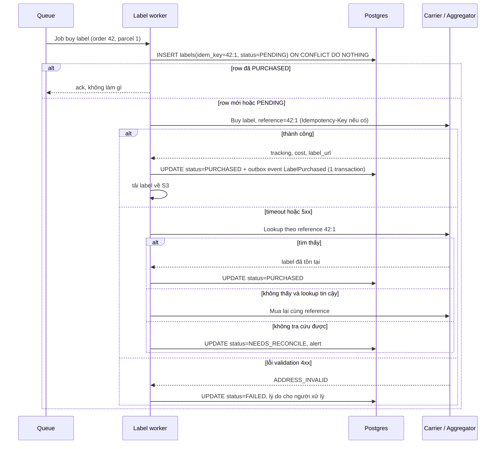

## Bối cảnh & vấn đề

Một buổi chiều cao điểm, worker gọi API mua label của carrier. Carrier nhận request, tạo label, ghi phí vào tài khoản, rồi trên đường trả response thì kết nối bị reset. Phía worker chỉ thấy `ETIMEDOUT`. Code "chuẩn" của nhiều team là bắt lỗi và retry. Request thứ hai tạo một label **mới**, tracking **mới**, phí **mới**. Kho in label thứ hai, label thứ nhất bị bỏ quên. Cuối tháng, finance thấy 140 đơn bị tính hai label.

Đây là bài toán kinh điển của mọi API có **side effect tốn tiền**, giống thanh toán: **timeout không có nghĩa là thất bại, nó có nghĩa là không biết**. Với payment, Stripe giải quyết bằng `Idempotency-Key`. Với carrier, tình hình khó hơn: nhiều API carrier **không hỗ trợ idempotency key**, nên bạn phải tự thiết kế lớp an toàn.

Interviewer hỏi về mua label để xem bạn có phân biệt được **read an toàn để retry** và **write có tiền** không, và bạn có biết các kỹ thuật: ghi trạng thái trước khi gọi, unique constraint theo nghiệp vụ, lookup theo reference, reconcile. Bài trước về [domain vận chuyển](/tracks/shipping-apis/learn/shipping-domain) giải thích vì sao label là một giao dịch tài chính.

## Khái niệm

### Idempotency và idempotency key

Một thao tác **idempotent** khi thực hiện nhiều lần cho kết quả giống thực hiện một lần. GET rate là idempotent tự nhiên. POST "mua label" thì không: mỗi lần gọi tạo một label mới.

**Idempotency key** là một chuỗi do client tạo, gửi kèm request ghi. Server lưu key cùng kết quả lần đầu. Gặp lại cùng key thì trả lại kết quả cũ thay vì làm lại. Điều kiện để nó hoạt động: key phải **ổn định qua các lần retry** (tạo một lần và lưu lại, không tạo ngẫu nhiên mỗi lần), và nên **suy ra từ nghiệp vụ**, ví dụ `order_id:fulfillment_id:parcel_no`, để hai worker độc lập cũng ra cùng key.

**Interview angle:** câu hỏi bẫy là "mỗi lần retry tạo UUID mới làm idempotency key có được không". Không: key mới thì server coi là request mới.

### Reference và lookup

Khi provider không hỗ trợ idempotency key, kỹ thuật thay thế là gắn **reference do mình tạo** vào shipment (customer reference, shipment reference, metadata) rồi **tìm lại theo reference** khi kết quả không rõ. Nếu tìm thấy label đã tạo, dùng label đó. Nếu không tìm thấy, mới mua lại. Một số aggregator cho phép tạo **shipment object trước** (có id), rồi gọi "buy" trên id đó; mua lần hai trên cùng shipment thường bị từ chối hoặc trả về label đã mua (verify hành vi cụ thể của provider bạn dùng). Như vậy chính shipment id trở thành khoá idempotency tự nhiên.

### Trạng thái label: PENDING, PURCHASED, FAILED, NEEDS_RECONCILE

Thay vì "đã mua / chưa mua", label cần một **state machine** nhỏ:

- `PENDING`: đã ghi ý định mua vào DB, chưa biết kết quả.
- `PURCHASED`: có tracking number, cost, file label.
- `FAILED`: carrier trả lỗi rõ ràng, không retry được (địa chỉ sai, service không hỗ trợ tuyến). Không có tiền bị tính.
- `NEEDS_RECONCILE`: kết quả không rõ và không tra cứu được. **Không tự động mua lại**; job đối soát hoặc người xử lý.

Ghi `PENDING` **trước** khi gọi carrier là mấu chốt: nếu process chết giữa chừng, khi khởi động lại bạn biết có một lần mua dang dở cần kiểm tra, thay vì coi như chưa từng có.

### Retryable và non-retryable

Phân loại lỗi trước khi quyết định retry. **Retryable**: timeout, connection reset, HTTP 5xx, 429 (tôn trọng `Retry-After` nếu có). **Không retryable**: 400 validation, 401/403 credential, 404. Và quan trọng hơn mã lỗi là **loại thao tác**: rate, track, validate address là read, retry thoải mái với backoff. Mua label, tạo pickup, tạo manifest là write, chỉ retry khi có idempotency key hoặc sau khi lookup.

Retry đúng cách là **exponential backoff + jitter** (đợi 200 ms, 400 ms, 800 ms… cộng ngẫu nhiên) và có **retry budget**, để khi carrier đang sập bạn không nhân lưu lượng gấp 3 lần và làm sự cố tệ hơn.

### Multi-parcel và partial fulfillment

Một order có thể gồm nhiều **parcel** (ba thùng) và nhiều **fulfillment** (hai thùng gửi hôm nay, một thùng backorder gửi tuần sau). Một số carrier hỗ trợ **multi-piece shipment**: một master tracking và các child tracking (FedEx MPS là ví dụ hay được nhắc, verify chi tiết). Carrier khác chỉ cho tạo các shipment rời. Adapter phải che sự khác biệt này, và idempotency key phải đủ chi tiết đến **parcel**, nếu không thì thùng thứ hai bị coi là trùng với thùng thứ nhất.

## Cơ chế hoạt động

Luồng mua label an toàn, gồm cả nhánh timeout:



Đi qua từng bước. **Bước 1**: insert với unique `idem_key`. Nếu queue giao job hai lần (at-least-once), hoặc người dùng bấm nút hai lần, hai worker cùng insert sẽ có một bên thua ở constraint. Bên thua đọc lại row và không gọi carrier nếu row đã `PURCHASED`. Để chặn hẳn hai worker cùng gọi carrier khi row đang `PENDING`, có thể `SELECT … FOR UPDATE SKIP LOCKED` hoặc dùng lease có thời hạn trên row.

**Bước 2**: gọi carrier kèm reference ổn định. **Bước 3**, nhánh thành công: cập nhật DB và ghi **outbox event** trong cùng transaction, để email "đơn đã gửi" và các hệ thống khác nhận event mà không có tình trạng DB cập nhật nhưng event mất (xem thêm pattern outbox ở track 35). **Bước 3**, nhánh timeout: lookup trước khi làm gì khác. Chỉ khi chắc chắn chưa có label mới mua lại. Khi không chắc, dừng ở `NEEDS_RECONCILE`.

**Lưới an toàn cuối** là job reconcile: định kỳ lấy danh sách label đã tính tiền từ provider (API list shipments, billing report) so với DB. Label có ở provider mà không có trong DB, hoặc hai label cho một parcel, sẽ được void nếu còn trong cửa sổ cho phép.

## Ví dụ thực tế

### Mô phỏng: retry ngây thơ và retry an toàn

Đoạn code mô phỏng một carrier **tính tiền rồi mới timeout**. So sánh hai cách xử lý. Chạy bằng `npx tsx label.ts`.

```ts
// Simulates a carrier whose buy-label call times out AFTER it has already charged us.
type Label = { trackingNo: string; reference: string; costCents: number };
const carrierLedger: Label[] = [];                 // what the carrier bills us for
let n = 0;
const carrier = {
  async buy(reference: string, opts: { failAfterCharge: boolean }): Promise<Label> {
    const label = { trackingNo: `1Z${String(++n).padStart(6, '0')}`, reference, costCents: 870 };
    carrierLedger.push(label);
    if (opts.failAfterCharge) throw new Error('ETIMEDOUT');
    return label;
  },
  async findByReference(reference: string) {
    return carrierLedger.find((l) => l.reference === reference) ?? null;
  },
};

// Naive: retry with a new request on timeout
async function naiveBuy(orderId: string) {
  for (let attempt = 1; attempt <= 2; attempt++) {
    try { return await carrier.buy(`${orderId}-try${attempt}`, { failAfterCharge: attempt === 1 }); }
    catch { /* retry */ }
  }
}

// Safe: stable reference + lookup before buying again
const db = new Map<string, { status: 'PENDING' | 'PURCHASED' | 'NEEDS_RECONCILE'; label?: Label }>();
async function safeBuy(orderId: string, parcelNo: number) {
  const key = `${orderId}:${parcelNo}`;
  const row = db.get(key);
  if (row?.status === 'PURCHASED') return row.label;            // already done
  db.set(key, { status: 'PENDING' });
  try {
    const label = await carrier.buy(key, { failAfterCharge: !row }); // first attempt times out
    db.set(key, { status: 'PURCHASED', label });
    return label;
  } catch {
    const existing = await carrier.findByReference(key);         // did it actually go through?
    if (existing) { db.set(key, { status: 'PURCHASED', label: existing }); return existing; }
    db.set(key, { status: 'NEEDS_RECONCILE' });
    throw new Error(`unknown outcome for ${key}`);
  }
}

(async () => {
  await naiveBuy('ord_1');
  console.log('naive  -> labels billed:', carrierLedger.filter((l) => l.reference.startsWith('ord_1')).length);
  const l = await safeBuy('ord_2', 1);
  await safeBuy('ord_2', 1);                                     // duplicate job delivery
  console.log('safe   -> labels billed:', carrierLedger.filter((x) => x.reference.startsWith('ord_2')).length, 'tracking', l?.trackingNo, db.get('ord_2:1')?.status);
})();
```

Output:

```text
naive  -> labels billed: 2
safe   -> labels billed: 1 tracking 1Z000003 PURCHASED
```

Cách ngây thơ bị tính tiền hai label vì lần retry dùng reference mới, nên không cách nào biết lần đầu đã thành công. Cách an toàn dùng reference ổn định `ord_2:1`: khi timeout, nó tra cứu, thấy label đã tồn tại và dùng luôn. Job bị giao trùng lần hai thấy `PURCHASED` và không gọi carrier. Trong code thật, `db` là Postgres với unique constraint, không phải `Map` trong memory.

### Schema tối thiểu trong Postgres

```sql
create table shipment_labels (
  id            bigint generated always as identity primary key,
  tenant_id     uuid    not null,
  idem_key      text    not null,           -- order_id:fulfillment_id:parcel_no
  status        text    not null check (status in ('PENDING','PURCHASED','FAILED','NEEDS_RECONCILE','VOIDED')),
  carrier       text    not null,
  provider_ref  text,                       -- shipment id / reference at the provider
  tracking_no   text,
  cost_cents    integer,
  currency      char(3),
  label_key     text,                       -- S3 key of the stored label file
  updated_at    timestamptz not null default now(),
  unique (tenant_id, idem_key)
);
```

`unique (tenant_id, idem_key)` là lớp chặn trùng cứng nhất: dù code có bug, DB vẫn không cho hai label cho cùng một parcel.

## Trade-offs & lựa chọn thay thế

| Cách chống trùng | Ưu điểm | Nhược điểm | Khi nào dùng |
|---|---|---|---|
| Idempotency key của provider | Đơn giản, provider đảm bảo | Không phải provider nào cũng hỗ trợ; key có thời hạn lưu | Khi provider hỗ trợ (kiểm tra docs) |
| Shipment object trước, buy theo id | Tự nhiên với aggregator | Phụ thuộc hành vi "buy hai lần" của provider | EasyPost/Shippo-style API (verify) |
| Reference + lookup | Hoạt động cả với direct carrier | Cần endpoint search; có độ trễ index | Direct carrier có search theo reference |
| Unique constraint + PENDING trong DB | Chặn trùng phía mình, không phụ thuộc provider | Không chặn được trùng do timeout nếu thiếu lookup | Luôn luôn, làm nền cho các cách trên |
| Reconcile + void | Bắt mọi thứ lọt lưới | Phát hiện muộn, chỉ cứu được trong cửa sổ void | Luôn luôn, là lưới an toàn cuối |

| Mua label | Đồng bộ trong request | Bất đồng bộ qua queue |
|---|---|---|
| UX | Kho thấy label ngay | Cần màn hình tiến độ |
| Chịu lỗi | Request treo theo carrier | Retry có kiểm soát, rate limit theo account |
| Phù hợp | Mua lẻ từng kiện | Batch hàng trăm đến hàng nghìn kiện |

Trong thực tế bạn **xếp lớp**: unique constraint + PENDING (luôn có), cộng idempotency key hoặc lookup (tuỳ provider), cộng reconcile (luôn có). Câu trả lời senior không chọn một kỹ thuật duy nhất mà giải thích mỗi lớp chặn được loại lỗi nào.

## Edge cases & failure modes

- **Worker chết sau khi carrier tính tiền nhưng trước khi ghi DB**: row kẹt `PENDING`. Job quét row `PENDING` quá N phút → lookup theo reference → cập nhật hoặc chuyển `NEEDS_RECONCILE`.
- **Lookup có độ trễ (eventual consistency)**: label vừa tạo chưa xuất hiện trong search. Lookup ngay sau timeout trả về "không thấy" → mua lại → trùng. Giảm rủi ro: đợi vài giây rồi lookup lại; chỉ mua lại khi provider đảm bảo search nhất quán.
- **Hai worker cùng xử lý một row PENDING**: cần lock hoặc lease (`FOR UPDATE SKIP LOCKED`, hoặc cột `locked_until`) để chỉ một worker gọi carrier.
- **Batch 5,000 label trước cutoff**: nút thắt là **rate limit của carrier account**, không phải CPU. Cần token bucket theo account, ưu tiên đơn express, tách lỗi không retry được (địa chỉ sai) sang hàng chờ xử lý tay ngay, và alert sớm (ví dụ 30 phút trước cutoff) nếu còn tồn.
- **Carrier trả 503 hàng loạt sát cutoff**: các lựa chọn cho quản lý kho gồm chờ và chấp nhận gửi ngày mai, chuyển một phần sang carrier khác theo rule đã duyệt, hoặc ưu tiên đơn có cam kết. Hệ thống phải cho phép các lựa chọn này mà không cần sửa code.
- **Multi-parcel**: một thùng mua thành công, thùng thứ hai lỗi. Order ở trạng thái `partially_labeled`, không được báo "đã gửi" cho khách.
- **Void trùng**: void là thao tác gần idempotent, nhưng lần hai thường trả lỗi "already voided". Adapter phải map lỗi đó thành thành công.

## Pitfalls

- ❌ Retry mua label khi timeout bằng request mới → ✅ lookup theo reference hoặc retry với **cùng** idempotency key.
- ❌ Tạo idempotency key ngẫu nhiên mỗi lần retry → ✅ key suy ra từ nghiệp vụ, tạo một lần và lưu trong DB.
- ❌ Idempotency key theo `order_id` → ✅ theo `order_id:fulfillment_id:parcel_no`, nếu không multi-parcel sẽ hỏng.
- ❌ Gọi carrier rồi mới insert vào DB → ✅ insert `PENDING` trước, để crash giữa chừng vẫn để lại dấu vết.
- ❌ Chỉ debounce nút "Buy" ở frontend → ✅ chặn ở DB (unique) và ở consumer (idempotent), vì queue và retry cũng gây trùng.
- ❌ Retry mọi lỗi giống nhau → ✅ phân loại theo thao tác và mã lỗi; 400 không retry, 429 theo `Retry-After`.
- ❌ Không có reconcile → ✅ job hằng ngày so label đã tính tiền với DB, void label mồ côi trong cửa sổ cho phép.

## Tóm tắt

- Mua label = **side effect có tiền, không idempotent phía carrier**. Timeout nghĩa là **không biết kết quả**, không phải thất bại.
- Ba lớp: **unique idem_key + PENDING trong DB**, **idempotency key/reference + lookup** phía provider, **reconcile + void** làm lưới cuối.
- Key phải **ổn định** và **suy ra từ nghiệp vụ** đến mức parcel.
- Read (rate, track, address) retry thoải mái với backoff + jitter; write (label, pickup, manifest) chỉ retry khi chắc chắn an toàn.
- Batch trước cutoff: queue + rate limit theo account + ưu tiên + hàng chờ xử lý tay + alert sớm.
- Cập nhật trạng thái và phát event bằng **outbox** trong cùng transaction.
