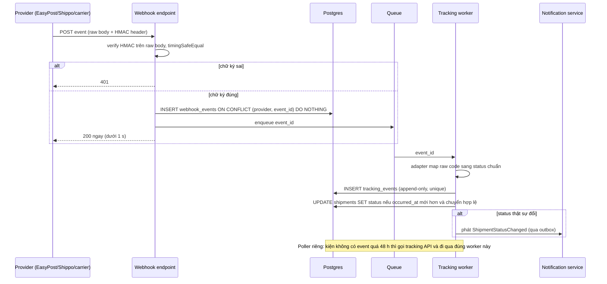

## Bối cảnh & vấn đề

Support nhận ticket: "Khách nói đã nhận hàng từ thứ Ba, sao app vẫn hiện Đang vận chuyển?". Kiểm tra thì thấy khoảng 3% kiện tuần này kẹt ở `in_transit`. Lần theo log: hai tuần trước, ai đó rotate webhook secret ở dashboard của aggregator nhưng quên cập nhật biến môi trường. Từ đó mọi webhook của một provider đều bị trả 401, provider retry vài ngày rồi bỏ. Không ai biết vì không có alert nào cho chuyện "webhook không về".

Một ticket khác: "Tôi nhận được email Đã giao, rồi một giờ sau lại nhận email Đang giao hàng". Nguyên nhân: một event scan cũ đến muộn và ghi đè trạng thái `delivered`.

Tracking trông đơn giản ("lấy status rồi hiển thị"), nhưng thật ra nó là **xử lý một dòng event không tin cậy** từ hệ thống bên ngoài: event có thể **trùng**, **sai thứ tự**, **mất**, hoặc mang **mã lạ**. Bài này giải quyết bốn vấn đề đó. Nó nối tiếp vòng đời trong [bài domain](/tracks/shipping-apis/learn/shipping-domain) và dùng các nguyên tắc idempotency đã gặp ở [bài mua label](/tracks/shipping-apis/learn/label-purchase-idempotency).

## Khái niệm

### Tracking event và raw code

Mỗi lần kiện được scan (nhận tại bưu cục, rời hub, đến hub, đang giao, giao thành công, giao thất bại), carrier tạo một **tracking event**: thời điểm xảy ra (`occurred_at`), địa điểm, mã sự kiện riêng của carrier, mô tả. Mỗi carrier có hàng trăm mã như vậy, đặt tên khác nhau, và thỉnh thoảng thêm mã mới. **Raw code** phải được lưu nguyên vẹn để debug và tính lại khi mapping thay đổi.

### Normalized status

Sản phẩm không thể hiển thị "UPS code X, FedEx code Y". Hệ thống cần một **enum chuẩn** nhỏ, ví dụ: `pre_transit` (đã tạo label, chưa scan), `in_transit`, `out_for_delivery`, `available_for_pickup`, `delivered`, `exception` (trễ, hỏng, sai địa chỉ, giao thất bại), `return_to_sender`, `cancelled`, `unknown`. Bộ status chuẩn của EasyPost là một tham chiếu tốt. Mỗi adapter giữ **bảng mapping** `(carrier, raw_code) → status`. Mã chưa biết map về `unknown`, kèm log và metric, **không throw**.

### State machine theo occurred_at

Status hiện tại của kiện là kết quả của một **state machine**: chỉ cho phép các chuyển hợp lệ (`in_transit → out_for_delivery → delivered`, `exception → in_transit`), và so thứ tự theo **`occurred_at`** (thời điểm scan), không theo thời điểm hệ thống nhận event. Event cũ đến muộn vẫn được thêm vào **lịch sử** (khách xem timeline), nhưng không kéo status hiện tại lùi lại. "Delayed" không phải status mà là **cờ suy ra** (EDD đã qua mà chưa `delivered`).

### Webhook at-least-once

**Webhook** là provider gọi HTTP POST tới endpoint của bạn khi có event. Gần như mọi provider giao webhook theo kiểu **at-least-once**: nếu không nhận được 2xx kịp thời, họ gửi lại theo lịch retry, nên bạn **sẽ** nhận trùng. Họ cũng không đảm bảo thứ tự. Và nếu endpoint lỗi đủ lâu, họ **bỏ cuộc**, nên event có thể mất hẳn.

### HMAC signature

Endpoint webhook là URL public, ai cũng gọi được. Để chắc request đến từ provider, provider tính **HMAC-SHA256** của **raw body** bằng một secret chung, gửi kèm trong header (EasyPost có header chữ ký HMAC, verify tên và format header theo docs hiện tại). Bạn tính lại HMAC trên **đúng chuỗi byte nhận được** và so sánh bằng **`crypto.timingSafeEqual`**. Có hai lỗi kinh điển: tính HMAC trên `JSON.stringify(req.body)` sau khi đã parse (chuỗi khác byte gốc), và so sánh bằng `===` (về lý thuyết bị timing attack).

### Polling

**Polling** là định kỳ gọi tracking API theo tracking number. Nó chắc chắn có dữ liệu (nếu carrier có), nhưng tốn quota và có độ trễ theo chu kỳ. Trong thiết kế tốt, polling là **lưới an toàn** cho kiện "im lặng" (không có event mới quá N giờ), không phải cơ chế chính.

## Cơ chế hoạt động

Pipeline nhận và xử lý tracking event:



Đọc từng bước. **Endpoint chỉ làm ba việc**: verify chữ ký, lưu event thô (dedupe bằng unique constraint), trả 200. Không gọi API khác, không gửi email, không tính toán nặng trong request. Lý do: provider có timeout ngắn; xử lý lâu thì provider coi là thất bại và gửi lại, tạo thêm trùng lặp. Lỗi trong logic xử lý (ví dụ mapping throw) cũng không được làm endpoint trả 500, vì provider sẽ retry mãi một event mà retry không giúp được gì.

**Worker** xử lý bất đồng bộ. Nó map raw code, ghi vào bảng `tracking_events` append-only, rồi cập nhật status của shipment bằng một **conditional update**: chỉ đổi khi event mới hơn event hiện tại và phép chuyển hợp lệ. Thông báo cho khách chỉ phát khi status **thật sự đổi**, đi qua outbox. Vì event thô đã lưu, khi sửa bug mapping bạn có thể **replay**.

**Poller** dùng chung worker: nó lấy danh sách kiện chưa ở trạng thái cuối và không có event quá ngưỡng, gọi tracking API, rồi đẩy event vào cùng pipeline. Nhờ vậy chỉ có một chỗ chứa logic state machine.

Câu lệnh update an toàn khi nhiều worker chạy song song:

```sql
update shipments s
set status = $2, last_event_at = $3
where s.id = $1
  and (s.last_event_at is null or s.last_event_at < $3)       -- only newer events move the status
  and s.status not in ('delivered', 'return_to_sender', 'cancelled')  -- terminal states stay terminal
returning s.status;                                           -- 0 rows = stale or duplicate, no notification
```

Điều kiện nằm **trong** câu `UPDATE`, nên Postgres đánh giá nó dưới row lock: hai worker xử lý hai event cùng shipment sẽ không ghi đè nhau (không có lost update như kiểu read-modify-write trong code). Ma trận chuyển hợp lệ đầy đủ có thể đặt trong bảng `status_transitions` hoặc kiểm tra thêm trong code trước khi chạy update.

## Ví dụ thực tế

### Verify HMAC và xử lý event sai thứ tự

Chạy bằng `npx tsx webhook.ts`.

```ts
import crypto from 'node:crypto';
const secret = 'whsec_test';
// bytes exactly as the provider sent them (note the spacing and key order)
const raw = Buffer.from('{"id":"evt_1", "description":"tracker.updated","result":{"status":"delivered"}}');
const sig = crypto.createHmac('sha256', secret).update(raw).digest('hex');   // provider side

function verify(body: Buffer, header: string | undefined) {
  if (!header) return false;
  const expected = Buffer.from(crypto.createHmac('sha256', secret).update(body).digest('hex'));
  const got = Buffer.from(header);
  return got.length === expected.length && crypto.timingSafeEqual(got, expected);
}
const reStringified = Buffer.from(JSON.stringify(JSON.parse(raw.toString('utf8'))));
console.log('verify(raw body)        :', verify(raw, sig));
console.log('verify(JSON.stringify)  :', verify(reStringified, sig));
console.log('verify(missing header)  :', verify(raw, undefined));

// state machine: apply events in arrival order, keep the newest by occurredAt
const rank: Record<string, number> = { pre_transit: 0, in_transit: 1, out_for_delivery: 2, delivered: 3 };
type Evt = { id: string; status: string; occurredAt: string };
const arrivals: Evt[] = [
  { id: 'e1', status: 'in_transit', occurredAt: '2026-10-14T08:00:00Z' },
  { id: 'e3', status: 'delivered', occurredAt: '2026-10-14T12:00:00Z' },
  { id: 'e3', status: 'delivered', occurredAt: '2026-10-14T12:00:00Z' },        // duplicate
  { id: 'e2', status: 'out_for_delivery', occurredAt: '2026-10-14T09:30:00Z' }, // late
];
let naive = 'pre_transit';
const naiveNotified: string[] = [];
const seen = new Set<string>();
let cur = { status: 'pre_transit', at: '' };
const notified: string[] = [];
for (const e of arrivals) {
  naive = e.status; naiveNotified.push(e.status);
  if (seen.has(e.id)) continue;
  seen.add(e.id);
  if (e.occurredAt > cur.at && rank[e.status] >= rank[cur.status]) { cur = { status: e.status, at: e.occurredAt }; notified.push(e.status); }
}
console.log('naive last-write-wins   :', naive, '| notifications:', naiveNotified.join(', '));
console.log('ordered + deduped       :', cur.status, '| notifications:', notified.join(', '));
```

Output:

```text
verify(raw body)        : true
verify(JSON.stringify)  : false
verify(missing header)  : false
naive last-write-wins   : out_for_delivery | notifications: in_transit, delivered, delivered, out_for_delivery
ordered + deduped       : delivered | notifications: in_transit, delivered
```

Ba dòng đầu cho thấy vì sao "parse rồi stringify lại" làm hỏng chữ ký: body gốc có một khoảng trắng sau dấu phẩy, `JSON.stringify` bỏ nó đi, nên HMAC khác. Test local thường pass vì test tự tạo body bằng `JSON.stringify`, nên hai bên trùng nhau một cách tình cờ. Trong Express, giữ raw body bằng `express.raw({ type: 'application/json' })` cho route webhook.

Hai dòng cuối là bug "Delivered rồi quay về Out for delivery" (Q030). Bản naive gửi khách bốn thông báo, trong đó có một "delivered" trùng và một "out for delivery" sau khi đã giao. Bản đúng dedupe theo event id, so theo `occurredAt`, và chỉ thông báo khi status tiến lên.

## Trade-offs & lựa chọn thay thế

| Cách nhận tracking | Ưu điểm | Nhược điểm | Dùng khi |
|---|---|---|---|
| Webhook | Gần realtime, không tốn quota | Trùng, sai thứ tự, có thể mất; cần endpoint public + verify | Đường chính |
| Polling | Chắc chắn có dữ liệu, đơn giản | Tốn quota, trễ theo chu kỳ, rate limit | Lưới an toàn cho kiện im lặng; carrier không có webhook |
| Hybrid | Nhanh + chắc | Hai đường vào, cần chung một pipeline | Production |

| Lưu trạng thái | Chỉ lưu status mới nhất | Event store append-only + status tính ra |
|---|---|---|
| Đơn giản | Có | Phức tạp hơn một chút |
| Debug, replay khi sửa mapping | Không thể | Có |
| Timeline cho khách | Không có | Có |

Chọn **hybrid + event store**. Polling nên thông minh: không poll kiện đã ở trạng thái cuối; tần suất phụ thuộc trạng thái (kiện `out_for_delivery` poll dày hơn kiện mới tạo label); poll kiện im lặng quá 48–72 giờ; và dùng rate limiter theo carrier. Với 2 triệu kiện đang hoạt động, poll đều mỗi giờ là 48 triệu call/ngày, không khả thi; poll có chọn lọc chỉ vài phần trăm con số đó.

## Edge cases & failure modes

- **Secret bị rotate mà không cập nhật**: mọi webhook trả 401. Hỗ trợ **hai secret song song** trong thời gian rotate, và alert khi tỉ lệ 401 ở endpoint webhook tăng.
- **Webhook về 0** trong giờ cao điểm: có thể là sự cố provider hoặc cấu hình. Alert theo "volume thấp bất thường so với cùng giờ tuần trước", không theo ngưỡng cố định (2 giờ sáng volume thấp là bình thường).
- **Mã raw mới**: map về `unknown`. Alert khi tỉ lệ `unknown` vượt ngưỡng; bổ sung mapping rồi replay.
- **Tracking number trùng giữa các tenant hoặc carrier**: định tuyến theo id do mình lưu (tracker id, shipment id), không chỉ theo tracking number; không tin field tenant trong payload.
- **Kiện tạo ngoài hệ thống** (merchant mua label tay): không có tracker, nên không bao giờ có event. Cần luồng "đăng ký tracking" cho tracking number nhập tay.
- **Provider retry dồn dập sau sự cố**: endpoint phải chịu được burst; dedupe bằng unique constraint khiến event trùng gần như không tốn gì.
- **Event `delivered` sai** (carrier scan nhầm), sau đó có event sửa: chính sách "terminal states stay terminal" cần ngoại lệ có kiểm soát, ví dụ cho phép support mở lại thủ công.

## Pitfalls

- ❌ HMAC trên `JSON.stringify(req.body)` → ✅ HMAC trên **raw body**.
- ❌ So sánh chữ ký bằng `===` → ✅ `crypto.timingSafeEqual` với hai buffer cùng độ dài.
- ❌ Xử lý toàn bộ rồi mới trả 200 → ✅ verify, lưu, ack nhanh, xử lý async.
- ❌ Trả 500 khi mapping throw → ✅ map về `unknown`, ack 200, xử lý lỗi trong worker có DLQ.
- ❌ Ghi đè status bằng event mới nhận → ✅ so theo `occurred_at`, conditional update, chỉ chuyển hợp lệ.
- ❌ Chỉ lưu status mới nhất → ✅ event store append-only để có timeline và replay.
- ❌ Gửi thông báo cho mỗi event → ✅ chỉ khi status chuẩn thật sự đổi.
- ❌ Không có alert cho "webhook im lặng" → ✅ metric volume theo provider + % kiện không có event quá N giờ.

## Tóm tắt

- Tracking là **dòng event không tin cậy**: trùng, sai thứ tự, mất, mã lạ.
- **Normalize** về enum nhỏ qua bảng mapping trong adapter; mã lạ thành `unknown`, không throw.
- **State machine theo `occurred_at`**, conditional update trong SQL, trạng thái cuối giữ nguyên.
- Webhook endpoint: **verify HMAC trên raw body** → **lưu + dedupe** → **ack 200 nhanh** → **xử lý async**.
- **Polling** là lưới an toàn cho kiện im lặng, chọn lọc theo trạng thái và có rate limit.
- Event store append-only để có timeline, replay và debug.
- Alert: 401 ở webhook, volume bất thường, tỉ lệ `unknown`, kiện kẹt quá N ngày.
