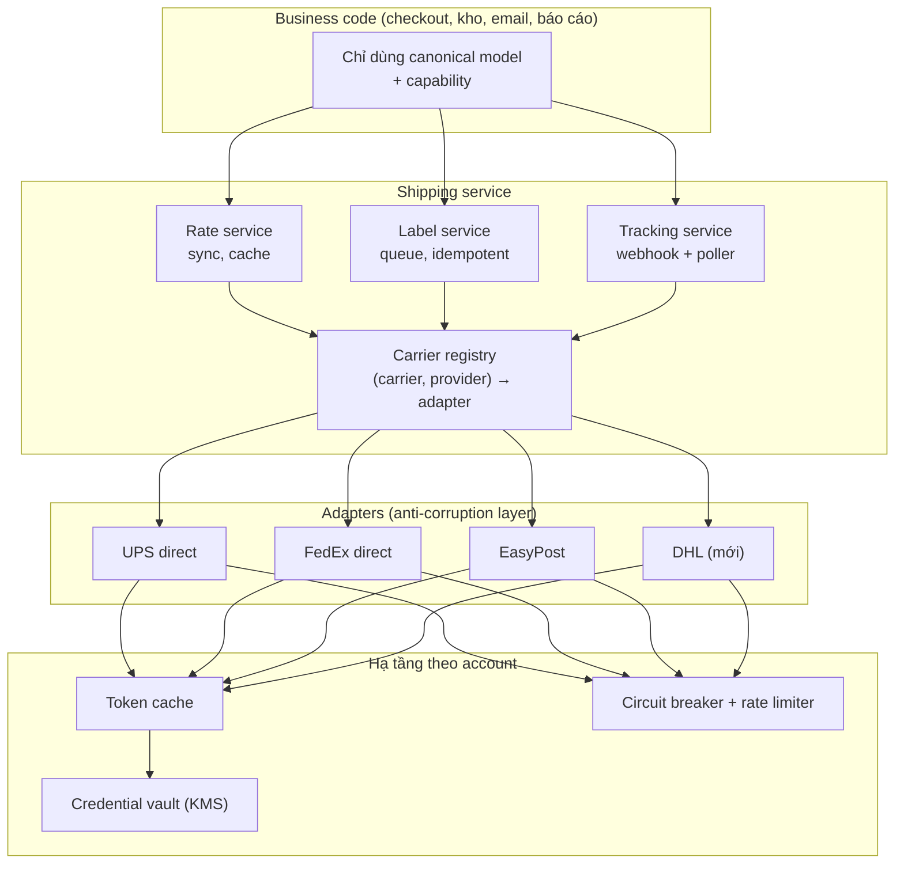

## Bối cảnh & vấn đề

Một codebase hai năm tuổi có 47 chỗ `if (carrier === 'ups')`. Checkout biết mã service `03` của UPS. Màn hình kho đọc trực tiếp `response.output.transactionShipments[0]` của FedEx. Email template hiển thị status thô "M" của một carrier. Product yêu cầu thêm DHL trong bốn tuần, và team ước tính cần ba tháng, vì phải sửa khắp nơi.

Đó là hệ quả của việc để **mô hình dữ liệu của carrier rò rỉ** vào business code. Câu hỏi thiết kế trung tâm của track này, và là thứ phân biệt "đã gọi được API" với "đã xây integration", là: **làm sao để thêm, bỏ hoặc đổi carrier mà business code không biết?**

Bài này tổng hợp các bài trước ([carrier API](/tracks/shipping-apis/learn/carrier-apis-auth), [rates](/tracks/shipping-apis/learn/address-rates-checkout), [label](/tracks/shipping-apis/learn/label-purchase-idempotency), [tracking](/tracks/shipping-apis/learn/tracking-webhooks)) thành một kiến trúc, rồi mở rộng lên multi-tenant và quy mô 100k shipment mỗi ngày.

## Khái niệm

### Canonical model

**Canonical model** là mô hình dữ liệu **của riêng bạn** cho domain shipping: `Address`, `Parcel`, `Shipment`, `RateQuote`, `Label`, `TrackingEvent`, `CustomsItem`. Nó dùng đơn vị chuẩn (gram, mm), tiền là số nguyên minor unit kèm currency, mã service của bạn (`ground`, `express_2day`), status chuẩn của bạn. Business code (checkout, kho, email, báo cáo) chỉ đọc mô hình này.

Mỗi bản ghi giữ thêm **raw payload** (cột `jsonb`) và id phía provider. Raw để debug, audit, và tính lại khi mapping đổi; business code không đọc nó. Tách `provider` (direct, easypost, shippo) khỏi `carrier` (ups, fedex) để đổi đường tích hợp mà không mất lịch sử.

### Adapter và anti-corruption layer

**Adapter** là lớp dịch giữa canonical model và API của một provider: build request, gọi API, parse response, convert đơn vị, map mã service, mã status, mã lỗi. Theo DDD, tập hợp các adapter là **anti-corruption layer**: nó ngăn khái niệm của hệ thống bên ngoài "làm bẩn" domain của bạn. Một **registry** chọn adapter theo `(carrier, provider)` của từng carrier account, giống Strategy pattern.

### Capability matrix

Không phải carrier hay provider nào cũng hỗ trợ mọi thao tác: void tự động, pickup, address validation, return label, paperless customs, multi-piece shipment. Thay vì `if (carrier === 'dhl')`, mỗi adapter **khai báo capability**. UI và luồng nghiệp vụ đọc capability: ẩn nút "Đặt pickup" khi không hỗ trợ, chuyển sang quy trình thủ công khi không void được qua API.

### Canonical error

Mỗi carrier trả lỗi một kiểu, có hãng còn trả HTTP 200 với lỗi nằm trong body. Adapter map tất cả về **canonical error**: `code` (`ADDRESS_INVALID`, `SERVICE_UNAVAILABLE_FOR_ROUTE`, `WEIGHT_LIMIT_EXCEEDED`, `AUTH_FAILED`, `RATE_LIMITED`, `CARRIER_UNAVAILABLE`, `UNKNOWN`), `retryable`, `userMessage`, và các field raw (`rawCode`, `rawMessage`, `carrierRequestId`). Ba đối tượng dùng nó: **UI** đọc `userMessage`, **retry logic** đọc `retryable`, **support** đọc raw để mở ticket với carrier.

### Đơn vị và tiền

USPS và UPS (US) làm việc bằng **lb/oz/inch**; DHL và phần lớn quốc tế dùng **kg/cm**; EasyPost nhận weight bằng **ounce**. Chọn một **canonical unit** (gram, mm) lưu trong DB, convert ở adapter, làm tròn **lên** theo quy tắc carrier ở bước cuối. Tiền là **integer minor unit** + `currency`. Parse chuỗi số tiền carrier trả về (`"17.40"`) bằng xử lý chuỗi hoặc decimal library, không bằng `parseFloat` rồi nhân.

### Credential theo tenant (BYOA) và isolation

Trên platform multi-tenant, merchant có thể kết nối **carrier account riêng** để dùng giá đàm phán. Credential lưu trong bảng `carrier_accounts`, secret mã hoá bằng **envelope encryption** (KMS tạo data key, data key mã hoá secret, chỉ ciphertext của data key được lưu cạnh dữ liệu). Mọi thứ có trạng thái theo account phải **key theo account**: token cache, circuit breaker, rate limiter, retry budget. Đó là **bulkhead**: account của tenant A lỗi không ảnh hưởng tenant B.

## Cơ chế hoạt động



Luồng một request: business code gọi Shipping service bằng canonical model. Service tìm carrier account của tenant, registry trả về adapter tương ứng. Adapter lấy token (cache theo account), đi qua circuit breaker và rate limiter của account, gọi API, rồi dịch response về canonical. Lỗi được dịch về canonical error trước khi ra khỏi adapter.

Thêm DHL nghĩa là thêm **một ô** trong lớp Adapters: implement interface, khai báo capability, viết mapping service/status/error, fixture test, cấu hình credential. Business code, API của shipping service và UI (ngoài việc có thêm option) không đổi. Nếu bạn thấy mình phải sửa checkout để thêm carrier, abstraction đang rò rỉ.

Interface tối thiểu của một adapter:

```ts
interface CarrierAdapter {
  readonly carrier: 'ups' | 'fedex' | 'usps' | 'dhl';
  readonly provider: 'direct' | 'easypost' | 'shippo';
  readonly capabilities: ReadonlySet<'void' | 'pickup' | 'address_validation' | 'return_label' | 'paperless_customs' | 'multi_piece'>;
  getRates(ctx: AccountCtx, s: CanonicalShipment, signal: AbortSignal): Promise<RateQuote[]>;
  buyLabel(ctx: AccountCtx, s: CanonicalShipment, rate: RateQuote, idemKey: string): Promise<LabelResult>;
  findLabelByReference(ctx: AccountCtx, idemKey: string): Promise<LabelResult | null>;
  voidLabel(ctx: AccountCtx, label: LabelRef): Promise<'voided' | 'already_voided' | 'not_voidable'>;
  track(ctx: AccountCtx, trackingNo: string): Promise<NormalizedEvent[]>;
  parseWebhook?(rawBody: Buffer, headers: Record<string, string>): NormalizedEvent[]; // throws CanonicalError
}
```

## Ví dụ thực tế

### Convert đơn vị và tiền, có test theo bảng

Bug ở Q025 (gửi kg vào field LBS, cm vào field IN, `parseFloat` rồi `toFixed`) là loại bug chỉ test theo bảng mới bắt được. Chạy bằng `npx tsx units.ts`.

```ts
// canonical: grams, millimeters, integer cents
const G_PER_LB = 453.59237, MM_PER_IN = 25.4;
export const toLb = (g: number) => Math.ceil((g / G_PER_LB) * 10) / 10;   // round UP to 0.1 lb
export const toIn = (mm: number) => Math.ceil((mm / MM_PER_IN) * 10) / 10;
export const toCents = (s: string) => {                                   // "17.40" -> 1740 without float math
  const [i, f = ''] = s.trim().split('.');
  return Number(i) * 100 + Number((f + '00').slice(0, 2));
};
const markup = (cents: number, bps: number) => Math.round((cents * (10_000 + bps)) / 10_000);

const cases: [string, unknown, unknown][] = [
  ['toLb(2000 g)', toLb(2000), 4.5],
  ['toIn(508 mm)', toIn(508), 20],
  ['toCents("17.40")', toCents('17.40'), 1740],
  ['toCents("8.2")', toCents('8.2'), 820],
  ['markup(1740, +10%)', markup(1740, 1000), 1914],
  ['float: 0.1 + 0.2 (expected FAIL)', 0.1 + 0.2, 0.3],
  ['float: (1.005).toFixed(2) (expected FAIL)', (1.005).toFixed(2), '1.01'],
];
for (const [name, got, want] of cases) console.log(got === want ? 'PASS' : 'FAIL', name.padEnd(42), '=>', got);
```

Output:

```text
PASS toLb(2000 g)                               => 4.5
PASS toIn(508 mm)                               => 20
PASS toCents("17.40")                           => 1740
PASS toCents("8.2")                             => 820
PASS markup(1740, +10%)                         => 1914
FAIL float: 0.1 + 0.2 (expected FAIL)           => 0.30000000000000004
FAIL float: (1.005).toFixed(2) (expected FAIL)  => 1.00
```

Năm dòng đầu là các hàm convert của adapter, kiểm tra bằng bảng input → output mong đợi. Hai dòng cuối cố ý thất bại để minh hoạ: float không biểu diễn chính xác 0.1, và `(1.005).toFixed(2)` cho `1.00` thay vì `1.01` vì 1.005 thực chất được lưu là 1.00499999…. Đặt các hàm convert trong **một module dùng chung** để adapter mới không viết lại (và viết sai) lần nữa. Hàm `toCents` ở đây giả định input đã hợp lệ; trong code thật nên validate format hoặc dùng decimal library.

### Chiến lược test cho carrier integration

```text
Unit (mỗi PR, nhanh)        mapping request/response, unit convert, status/error map, từ fixture JSON đã mask PII
Contract / recorded (CI)    replay HTTP đã ghi (Polly.js, nock, WireMock): adapter vẫn hiểu response thật
Live sandbox (nightly)      gọi sandbox thật, phát hiện carrier đổi API; fail thì alert, không chặn deploy
Go-live (một lần + định kỳ) vài label production thật rồi void, in ZPL trên máy kho, bật theo tenant bằng flag
Chaos (định kỳ)             giả lập timeout, 429, 500, webhook trùng, sai thứ tự
```

Sandbox khác production: dữ liệu tracking giả (EasyPost có tracking number test như `EZ1000000001` để giả lập trạng thái, verify), thiếu một số service và tuyến, giá khác. Vì vậy live sandbox test là **cảnh báo sớm**, không phải bằng chứng production chạy đúng.

## Trade-offs & lựa chọn thay thế

| Quyết định | Lựa chọn A | Lựa chọn B | Khi nào chọn |
|---|---|---|---|
| Vị trí adapter | Module trong monolith | Shipping service riêng | A khi team nhỏ, ít consumer. B khi nhiều service cần shipping, cần scale và deploy riêng |
| Mapping status/service | Hard-code trong adapter | Config có version (DB/file) | Code khi ít thay đổi và cần review. Config khi ops cần bổ sung mã mới nhanh |
| Credential | Platform account dùng chung | BYOA theo tenant | BYOA khi merchant có giá đàm phán; đổi lại cần vault, UX kết nối lại, isolation |
| Isolation | Breaker/limiter theo carrier | Theo carrier × account | Multi-tenant BYOA luôn theo account |
| Mô hình label | Đồng bộ | Queue | Queue cho batch và khi cần kiểm soát rate limit |

**Thiết kế 100k shipment/ngày (Q039)**, theo thứ tự trình bày trong phỏng vấn:

1. **Ước lượng**: 100k/ngày ≈ 1.2 label/s trung bình, nhưng dồn vào 2–3 giờ trước cutoff → peak 10–20/s. Tracking 5–10 event/kiện → khoảng 1M event/ngày, khoảng 12/s trung bình với burst lớn hơn. Rate request ở checkout gấp nhiều lần số đơn (nhiều khách xem rồi bỏ).
2. **Service**: Rate (sync, cache Redis), Label (queue + worker, Postgres với unique idem_key), Tracking (webhook ingest + poller + event store partition theo tháng), Billing/Reconcile (batch hằng ngày). Label file trên S3. Domain event qua outbox → Kafka.
3. **Nút thắt**: rate limit carrier theo account, không phải CPU. Token bucket theo account, fair queue theo tenant.
4. **Resilience**: timeout, breaker, bulkhead theo carrier × account; fallback rate; reconcile.
5. **Observability**: SLO cho rate p95, tỉ lệ label thành công, độ trễ xử lý tracking.

## Edge cases & failure modes

- **Carrier trả HTTP 200 với lỗi trong body**: adapter phải kiểm tra cấu trúc lỗi trong body, không chỉ status code.
- **Response có warning** (alerts, notes) mà không lỗi: lưu lại, vì đôi khi đó là cảnh báo deprecation hoặc address đã bị carrier sửa.
- **Noisy neighbor**: tenant lớn đẩy 20k label một lúc chiếm hết worker → concurrency cap theo tenant, fair scheduling.
- **Credential của một tenant hỏng**: chỉ account đó `needs_reauth`; job của tenant đó tạm dừng; tenant khác chạy bình thường.
- **Tracking number trùng giữa hai tenant** (cùng merchant dùng hai platform, hoặc nhập tay): định tuyến webhook theo id mình lưu, không theo tracking number đơn thuần.
- **Adapter mới thiếu capability**: luồng nghiệp vụ phải có nhánh thủ công (void qua support), không crash.
- **Đổi provider giữa chừng** (EasyPost sang direct UPS): kiện cũ vẫn track qua provider cũ cho đến khi kết thúc; dữ liệu phải ghi `provider` theo từng shipment.

## Pitfalls

- ❌ `if (carrier === ...)` trong business code → ✅ adapter + capability matrix.
- ❌ Trả response carrier thẳng cho frontend → ✅ chỉ canonical model ra khỏi shipping service.
- ❌ Lưu tiền bằng float, trộn currency → ✅ integer minor unit + currency, parse chuỗi.
- ❌ Gửi số mà không khai đơn vị, hoặc khai sai → ✅ canonical gram/mm, convert tập trung, test theo bảng.
- ❌ Secret carrier lưu plaintext → ✅ envelope encryption, chỉ adapter giải mã, audit.
- ❌ Một circuit breaker toàn cục cho mỗi carrier → ✅ theo carrier × account.
- ❌ Chỉ test happy path với sandbox → ✅ unit + recorded + nightly sandbox + chaos + go-live checklist.
- ❌ Bỏ raw payload để tiết kiệm chỗ → ✅ giữ raw (đã mask PII) để debug và replay.

## Tóm tắt

- **Canonical model + adapter** (anti-corruption layer): business code không biết carrier nào.
- Registry chọn adapter theo `(carrier, provider)` của carrier account; `provider` tách khỏi `carrier`.
- **Capability matrix** thay cho `if (carrier === ...)`; **canonical error** cho UI, retry và support.
- Đơn vị chuẩn **gram/mm**, tiền **integer minor unit**, convert tập trung, test theo bảng.
- Multi-tenant: credential **mã hoá theo tenant**, token cache, breaker, limiter **theo account**, fair queue.
- Test nhiều tầng: unit, recorded, nightly sandbox, chaos, go-live.
- Ở quy mô lớn, nút thắt là **rate limit của carrier** và **burst trước cutoff**, không phải CPU.
