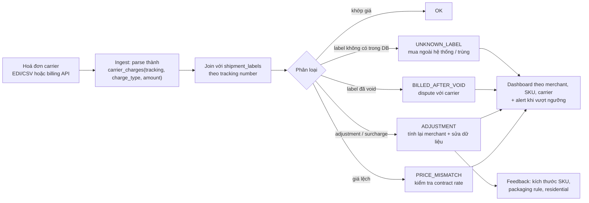
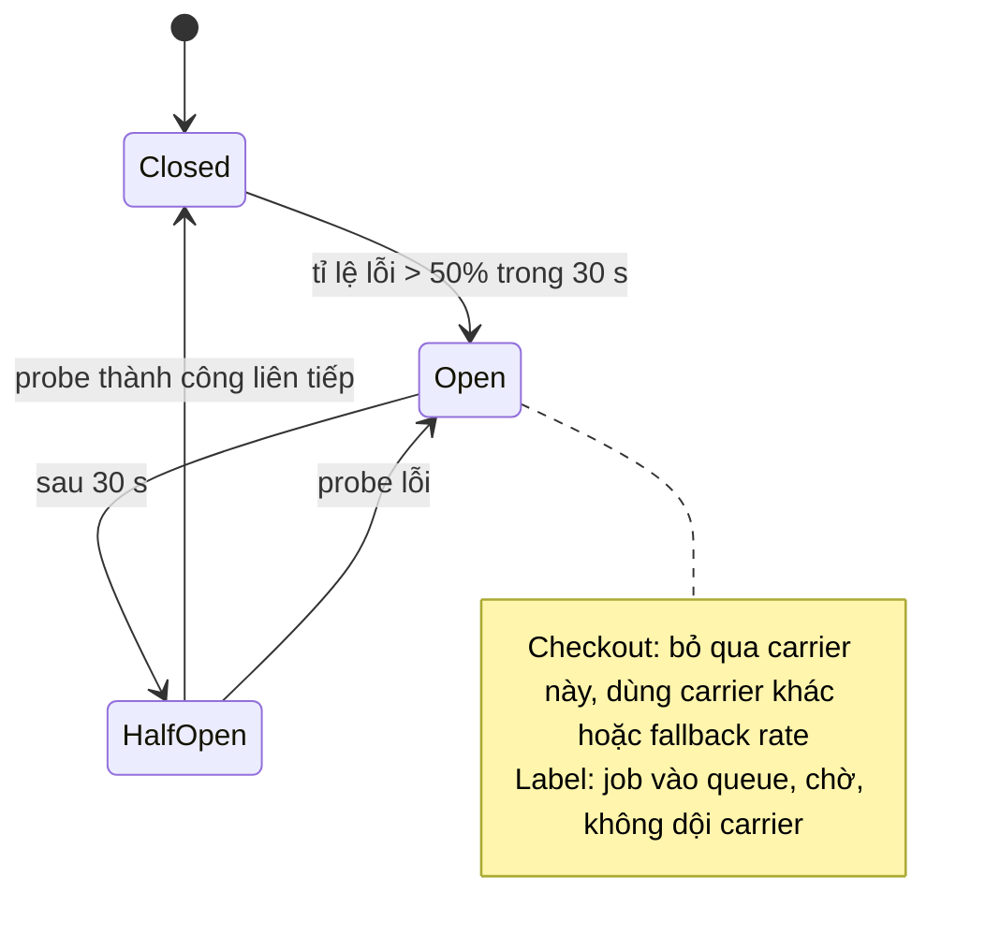

## Bối cảnh & vấn đề

Ba câu chuyện xảy ra trong cùng một quý. **Một**: kiện gửi sang UK bị giữ ở hải quan cả tuần vì mô tả hàng là "goods" và thiếu HS code; vài khách từ chối nhận vì bị thu thuế nhập khẩu khi giao hàng. **Hai**: hoá đơn tháng của carrier cao hơn tổng giá label trong DB 12%, và không ai giải thích được 12% đó đến từ đâu. **Ba**: Black Friday, API của một carrier lỗi 40% request trong hai giờ, checkout chậm, và kho ngồi chờ label.

Không câu chuyện nào là lỗi "gọi API sai". Chúng là phần **vận hành** của shipping integration: dữ liệu hải quan, tiền, sự cố, đo lường. Interviewer cho vị trí senior thường dành nửa sau buổi phỏng vấn cho đúng những thứ này, vì chúng cho thấy bạn đã thật sự **chạy** một integration trong production chứ không chỉ xây nó.

Bài cuối của track gom các chủ đề này lại, và kết thúc bằng cách biến kinh nghiệm integration của bạn (kể cả không phải shipping) thành câu trả lời thuyết phục. Nền tảng tiền và giá ở [bài domain](/tracks/shipping-apis/learn/shipping-domain); kiến trúc resilience ở [bài adapter](/tracks/shipping-apis/learn/adapter-architecture).

## Khái niệm

### Customs data và HS code

Gửi quốc tế cần khai **customs info** cho từng dòng hàng: mô tả cụ thể ("cotton t-shirt", không phải "clothes" hay "goods"), **HS code**, số lượng, giá trị, **country of origin** (nơi sản xuất, không phải nơi gửi), cân nặng. **HS code** (Harmonized System) là hệ mã phân loại hàng hoá do Tổ chức Hải quan Thế giới (WCO) quản lý: 6 số đầu thống nhất quốc tế, các nước có thể thêm số cho cấp chi tiết hơn. HS code quyết định thuế suất và hàng có bị hạn chế không.

Chứng từ: **commercial invoice** cho express (FedEx, UPS, DHL Express), **CN22/CN23** cho bưu chính (USPS quốc tế). Nhiều carrier hỗ trợ gửi chứng từ điện tử (**ETD**/paperless) thay vì in và dán. Ngoài ra có thể cần tax ID của người gửi hoặc người nhận theo quy định nước nhập (ví dụ EORI ở EU/UK, đăng ký VAT cho hàng giá trị thấp vào EU/UK; verify quy định hiện hành).

### Incoterms: DDP và DAP

**Incoterms** (do ICC ban hành) quy định ai chịu chi phí và rủi ro ở mỗi đoạn. Trong e-commerce, câu hỏi thực tế là **ai trả thuế và phí nhập khẩu**. **DDP** (Delivered Duty Paid): người gửi trả; khách nhận hàng không phải trả thêm, trải nghiệm tốt nhất, nhưng bạn phải tính và thu thuế ở checkout. **DAP** (Delivered At Place, thay cho DDU cũ): người nhận trả khi giao; rẻ cho người gửi, nhưng khách bất ngờ với hoá đơn thuế + phí xử lý của carrier và có thể từ chối nhận. Hàng bị từ chối thì phải trả về, tốn thêm tiền ship chiều về.

### Quote, label và invoice

Ba con số cho cùng một kiện: **quote** (giá hiển thị ở checkout, dựa trên cân/đo ước lượng), **label cost** (giá lúc mua label, dựa trên cân/đo khai báo), và **invoiced amount** (giá carrier tính thật trên hoá đơn, sau khi đo lại ở hub). Chúng lệch nhau vì: đóng gói thật khác ước lượng, carrier **DIM audit** phát hiện kích thước lớn hơn khai báo, **residential** phát hiện sau, **address correction**, **additional handling** (thùng quá dài hoặc nặng), fuel surcharge đổi giữa lúc quote và lúc giao.

### Reconciliation (đối soát)

**Đối soát** là so hoá đơn carrier (file chi tiết theo tracking number: EDI/CSV từ carrier, hoặc billing report/API của aggregator) với dữ liệu label của mình, phân loại từng chênh lệch, và hành động: tính lại cho merchant theo hợp đồng, **dispute** dòng sai với carrier, hoặc sửa dữ liệu nguồn (kích thước SKU, packaging rule, residential). Adjustment có thể đến **vài tuần** sau khi giao, nên billing với merchant phải có cơ chế điều chỉnh sau.

### SLO và observability cho integration

**SLI** là số đo (ví dụ "% rate request có ít nhất một rate trong 1.5 s"), **SLO** là mục tiêu cho số đo đó (99.5% trong 28 ngày). Với shipping integration, đo theo **carrier × operation × account**, và quan trọng không kém là **business metrics**: tỉ lệ label thành công, label trùng, kiện không có scan, kiện kẹt, tỉ lệ `unknown` status, chênh lệch quote–label–invoice. **Alert theo burn rate SLO** và theo bất thường so với baseline, không alert từng lỗi đơn lẻ.

## Cơ chế hoạt động

Pipeline đối soát hoá đơn carrier:



Đọc sơ đồ: bước ingest biến mọi định dạng hoá đơn về một bảng `carrier_charges` một dòng mỗi khoản phí. Bước join theo tracking number là trung tâm; mỗi dòng rơi vào một nhóm có **hành động rõ ràng**. Nhóm quan trọng nhất về dài hạn là **ADJUSTMENT**: nếu cùng một SKU liên tục bị DIM adjustment, dữ liệu kích thước SKU sai, và sửa nó giảm chênh lệch cho mọi đơn sau. Nhóm **UNKNOWN_LABEL** thường lộ ra label trùng do retry sai (xem [bài mua label](/tracks/shipping-apis/learn/label-purchase-idempotency)) hoặc label mua tay ngoài hệ thống.

Sự cố carrier mùa cao điểm đi qua circuit breaker theo carrier:



Khi breaker **Open**, checkout không gọi carrier đó nữa (dùng carrier khác hoặc fallback rate), còn label job ở lại trong queue thay vì retry dồn dập. **Half-open** chỉ cho một lượng nhỏ request "thăm dò" đi qua; thành công liên tiếp thì đóng lại, lỗi thì mở tiếp. Như vậy hệ thống hồi phục nhanh khi carrier ổn mà không gây **retry storm**.

## Ví dụ thực tế

### Đối soát một hoá đơn nhỏ

Bốn label trong DB (một đã void) và bảy dòng hoá đơn. Chạy bằng `npx tsx reconcile.ts`.

```ts
type Label = { tracking: string; costCents: number; status: 'PURCHASED' | 'VOIDED' };
type InvoiceLine = { tracking: string; chargeType: string; amountCents: number };
const labels: Label[] = [
  { tracking: '1Z001', costCents: 1432, status: 'PURCHASED' },
  { tracking: '1Z002', costCents: 1388, status: 'PURCHASED' },
  { tracking: '1Z003', costCents: 1290, status: 'VOIDED' },
  { tracking: '1Z004', costCents: 2890, status: 'PURCHASED' },
];
const invoice: InvoiceLine[] = [
  { tracking: '1Z001', chargeType: 'transportation', amountCents: 1432 },
  { tracking: '1Z002', chargeType: 'transportation', amountCents: 1388 },
  { tracking: '1Z002', chargeType: 'dim_adjustment', amountCents: 940 },
  { tracking: '1Z003', chargeType: 'transportation', amountCents: 1290 },
  { tracking: '1Z004', chargeType: 'transportation', amountCents: 2890 },
  { tracking: '1Z004', chargeType: 'residential', amountCents: 545 },
  { tracking: '1Z009', chargeType: 'transportation', amountCents: 1510 },
];
const byTracking = new Map(labels.map((l) => [l.tracking, l]));
const findings = invoice.flatMap((line) => {
  const l = byTracking.get(line.tracking);
  if (!l) return [{ ...line, finding: 'UNKNOWN_LABEL (bought outside system or duplicate?)' }];
  if (l.status === 'VOIDED') return [{ ...line, finding: 'BILLED_AFTER_VOID → dispute' }];
  if (line.chargeType !== 'transportation') return [{ ...line, finding: 'ADJUSTMENT → recharge merchant / fix data' }];
  if (line.amountCents !== l.costCents) return [{ ...line, finding: 'PRICE_MISMATCH' }];
  return [];
});
const dbTotal = labels.filter((l) => l.status === 'PURCHASED').reduce((s, l) => s + l.costCents, 0);
const invTotal = invoice.reduce((s, l) => s + l.amountCents, 0);
console.table(findings.map(({ tracking, chargeType, amountCents, finding }) => ({ tracking, chargeType, amountCents, finding })));
console.log({ dbTotalCents: dbTotal, invoiceTotalCents: invTotal, gapCents: invTotal - dbTotal });
```

Output:

```text
┌─────────┬──────────┬──────────────────┬─────────────┬───────────────────────────────────────────────────────┐
│ (index) │ tracking │ chargeType       │ amountCents │ finding                                               │
├─────────┼──────────┼──────────────────┼─────────────┼───────────────────────────────────────────────────────┤
│ 0       │ '1Z002'  │ 'dim_adjustment' │ 940         │ 'ADJUSTMENT → recharge merchant / fix data'           │
│ 1       │ '1Z003'  │ 'transportation' │ 1290        │ 'BILLED_AFTER_VOID → dispute'                         │
│ 2       │ '1Z004'  │ 'residential'    │ 545         │ 'ADJUSTMENT → recharge merchant / fix data'           │
│ 3       │ '1Z009'  │ 'transportation' │ 1510        │ 'UNKNOWN_LABEL (bought outside system or duplicate?)' │
└─────────┴──────────┴──────────────────┴─────────────┴───────────────────────────────────────────────────────┘
{ dbTotalCents: 5710, invoiceTotalCents: 9995, gapCents: 4285 }
```

Khoản chênh 4285 cents được giải thích trọn vẹn bằng bốn dòng: 940 + 1290 + 545 + 1510 = 4285. Đó là mục tiêu của đối soát: **không còn khoản chênh nào "không rõ nguồn gốc"**. Mỗi dòng có hành động: dispute 1Z003 (bị tính tiền dù đã void), điều tra 1Z009, tính lại hai adjustment cho merchant và kiểm tra kích thước SKU của 1Z002. Trong production, logic này là một câu SQL `LEFT JOIN` giữa `carrier_charges` và `shipment_labels`, chạy hằng ngày khi có dữ liệu billing mới.

### Customs info cho một đơn quốc tế (rút gọn)

```json
{
  "contents_type": "merchandise",
  "incoterm": "DDP",
  "customs_items": [
    { "description": "Men's cotton t-shirt", "hs_tariff_number": "610910",
      "origin_country": "VN", "quantity": 2, "value": "24.00", "currency": "USD", "weight_g": 400 }
  ],
  "eel_pfc": "NOEEI 30.37(a)"
}
```

`610910` là HS code 6 số cho áo T-shirt cotton dệt kim. `origin_country` là nơi sản xuất. `eel_pfc` là mã miễn khai báo xuất khẩu của Mỹ cho hàng giá trị thấp (verify điều kiện áp dụng). Tên field khác nhau theo provider; đây là hình dạng canonical mà adapter dịch sang.

## Trade-offs & lựa chọn thay thế

| Quyết định | Lựa chọn A | Lựa chọn B | Khi nào chọn |
|---|---|---|---|
| Thuế nhập khẩu | DDP (người gửi trả, thu ở checkout) | DAP (người nhận trả khi giao) | DDP cho thị trường quan trọng, giảm từ chối nhận. DAP khi biên lợi nhuận mỏng hoặc chưa tính được thuế chính xác; phải ghi rõ ở checkout |
| Ai chịu adjustment | Merchant (tính lại sau) | Platform (gộp vào phí) | Hợp đồng quyết định; hệ thống phải hỗ trợ tính lại sau vài tuần |
| Tần suất đối soát | Hằng tháng theo hoá đơn | Hằng ngày theo billing data | Hằng ngày phát hiện label trùng và void lỗi trong cửa sổ còn sửa được |
| Alert | Theo ngưỡng cố định | Theo SLO burn rate + bất thường so với baseline | Burn rate cho chất lượng dịch vụ; baseline cho volume (webhook về 0) |
| Khi carrier sập | Chờ carrier hồi phục | Chuyển carrier theo rule | Chuyển chỉ khi rule đã được business duyệt trước (express, SLA); không tự ý đổi carrier |

Ví dụ SLO cho shipping integration:

- **Rate**: 99.5% request ở checkout có ít nhất một rate trong 1.5 s.
- **Label**: 99.9% label job hoàn tất trong 5 phút kể từ khi vào queue (không tính lỗi dữ liệu như địa chỉ sai).
- **Tracking**: 99% event được xử lý trong 10 phút kể từ khi nhận.

## Edge cases & failure modes

- **Black Friday, carrier lỗi 40%**: checkout dùng breaker + fallback để vẫn chốt đơn; label job ở lại queue với concurrency giới hạn; ưu tiên đơn có cutoff/SLA; thông báo merchant; drain backlog có kiểm soát khi carrier hồi phục rồi đối soát.
- **Adjustment đến sau khi đã thu tiền merchant**: cần sổ điều chỉnh (ledger) và hoá đơn bổ sung, kèm chứng cứ (kích thước carrier đo được) để support không phải tranh cãi từng ticket.
- **HS code sai trên dữ liệu sản phẩm**: hàng bị giữ hoặc tính thuế sai hàng loạt. HS code và origin là **dữ liệu sản phẩm bắt buộc** trước khi cho bán quốc tế; owner là team catalog/compliance, engineering cung cấp validation và công cụ.
- **Hàng cấm hoặc hạn chế** (pin lithium, chất lỏng, mỹ phẩm): chặn ở checkout theo nước đến và theo service, không để lỗi xuất hiện lúc mua label.
- **Webhook về 0 lúc 2 giờ sáng**: có thể bình thường. So với baseline cùng giờ tuần trước để phân biệt với sự cố thật.
- **Dashboard chỉ có metrics kỹ thuật**: latency đẹp mà label trùng tăng vẫn không ai biết. Phải có business metrics.

## Pitfalls

- ❌ Mô tả "gift" hoặc "goods" để giảm thuế → ✅ mô tả thật, HS code đúng; khai sai là vi phạm pháp luật, không phải mẹo.
- ❌ DAP mà không báo khách → ✅ DDP, hoặc ghi rõ ở checkout "có thể phát sinh thuế khi nhận".
- ❌ Coi giá label là chi phí cuối → ✅ lưu quote, label và invoice cho từng shipment.
- ❌ Đối soát bằng tay mỗi tháng → ✅ pipeline tự động hằng ngày, mọi khoản chênh có nhóm và hành động.
- ❌ Retry dồn dập khi carrier sập → ✅ circuit breaker + backoff + queue.
- ❌ Alert từng lỗi đơn lẻ → ✅ alert theo burn rate và bất thường.
- ❌ Kể kinh nghiệm chung chung ("tôi đã tích hợp nhiều API") → ✅ STAR với số liệu: quy mô, sự cố, hành động, kết quả.

## Câu chuyện kinh nghiệm cho phỏng vấn

Q045 và Q046 kiểm tra bạn có **kinh nghiệm thật** với integration bên thứ ba không. Nếu bạn chưa tích hợp carrier trực tiếp, hãy dùng integration thật bạn đã làm (data provider, payment, OAuth) và **nối rõ ràng sang shipping**:

- **Normalize nhiều provider** về canonical model ↔ normalize rate, status, error của carrier.
- **Rate limit, retry có backoff** ↔ carrier 429 lúc peak.
- **Upsert idempotent, dedupe** ↔ webhook trùng, mua label idempotent.
- **Giữ raw payload để debug** ↔ raw carrier response, replay tracking.
- **Phát hiện provider đổi schema** ↔ deprecation của carrier API.

Rồi thừa nhận điểm khác: shipping có **side effect tốn tiền** (label) và **latency chặt ở checkout**. Một khung STAR gọn: *Situation* (API nào, quy mô), *Task* (bạn chịu trách nhiệm gì), *Action* (trong sự cố: phát hiện, cầm máu, giao tiếp; sau sự cố: timeout, breaker, idempotency, alert, test), *Result* (số liệu trước/sau), cộng một câu *reflection* về điều bạn sẽ làm khác.

## Tóm tắt

- Quốc tế: **mô tả thật + HS code + origin + giá trị**, chứng từ (commercial invoice, CN22/CN23, ETD), tax ID khi cần.
- **DDP** (người gửi trả thuế) giảm từ chối nhận; **DAP** phải được báo rõ ở checkout.
- Ba con số **quote ≠ label ≠ invoice**; lưu cả ba theo từng shipment.
- **Đối soát hằng ngày**: join hoá đơn với label theo tracking, phân loại, hành động, sửa dữ liệu nguồn.
- Sự cố carrier: **circuit breaker theo carrier**, fallback ở checkout, queue cho label, drain có kiểm soát.
- **SLO** cho rate, label, tracking; alert theo burn rate và bất thường; có business metrics.
- Khi kể kinh nghiệm: STAR với số liệu, nối rõ sang các vấn đề của shipping.
